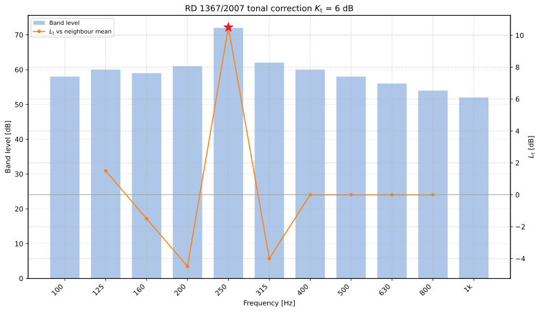
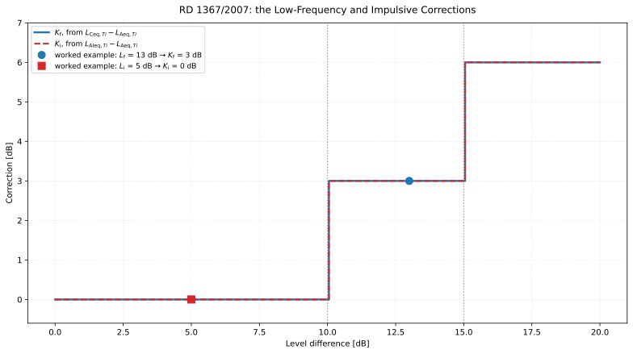
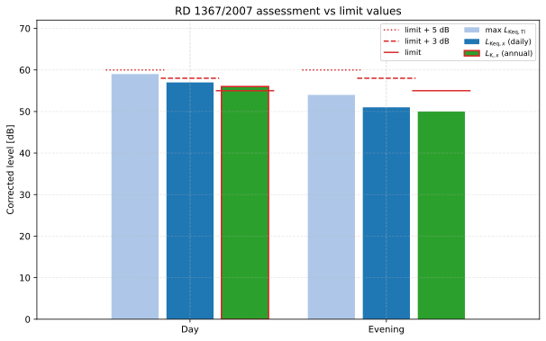

<!-- Written by `make llms` from site/src/content/docs/environment/assessment/spanish-noise-regulation.mdx: edit that page and its Spanish twin, then run `make llms`. -->

← [Documentation index](../../README.md) · Published at https://docs.jmrp.io/phonometry/environment/assessment/spanish-noise-regulation/

# Spanish Noise Regulation (RD 1367/2007)

Acoustic assessment in Spain does not stop at an $L_\mathrm{Aeq}$. Real Decreto
1367/2007, which develops Ley 37/2003 del Ruido, defines an index of its own,
the **corrected equivalent continuous sound pressure level** $L_{\mathrm{Keq},T}$, and
builds the whole compliance chain on it: the day is split into evaluation
periods, each period into noise phases, each phase is corrected for tonal,
low-frequency and impulsive character, the result is integrated up to an
annual value, and that value is compared against three different criteria read
off the same limit table. This page implements that chain end to end.

The per-period levels that feed it come from
[Integrated and Statistical Levels](../../signals/levels/levels.md), and the
European $L_\mathrm{den}$/$L_\mathrm{dn}$ indicators they coexist with, from
[Environmental Levels (ISO 1996-1/-2)](environmental-levels.md).

## How the inspection measurement goes (Annex IV)

For the inspection of an activity the indices are obtained by measurement and
by nothing else (Annex IV A.1), and the same annex says how the measurement is
made. No function of this page computes any of it: what follows is the
procedure the levels of the later sections are assumed to come from.

<picture><source media="(prefers-color-scheme: dark)" srcset="https://raw.githubusercontent.com/jmrplens/phonometry/main/.github/images/diagram_rd1367_inspection_dark.svg"></picture>

*Where the meter stands and what it reads: the positions come from Annex I A.3
and Annex IV A.3.4, the series from A.3.4.2 b and the precautions from A.3.5.*

**The instrument (Article 30, A.3.5 c).** The sound level meter and the
calibrator meet, as type 1/class 1 (Article 30.2), the Order of 25 September
2007 on the State metrological control of the instruments that measure
audible sound and of acoustic calibrators. Article 30.1 attributes it to the
Ministerio de Fomento; the Order of that date and title is Orden
ITC/2845/2007, issued by the Ministerio de Industria, Turismo y Comercio, and
it has been repealed with effect from 24 October 2020 by Orden ICT/155/2020,
of 7 February. Where octave or one-third-octave bands are needed, and
$K_\mathrm{t}$ always needs them, the filters meet type 1/class 1 of
UNE-EN 61260:1997 and UNE-EN 61260/A1:2002 (Article 30.3).
Type 2/class 2 instruments were tolerated for seven years after publication,
and never for a measurement behind a sanction or a court case (second
transitional provision). The chain is verified with the calibrator before and
after each measurement, within 0.3 dB of the initial reference value.

**The conditions (A.3.5).** Temperature and humidity stay within what the
maker of the instrument specifies. Outdoors the microphone always carries a
windscreen, a measurement in rain is not valid, and with more than 5 m/s of
wind at the evaluation point the measurement is abandoned. Indoors rain does
not forbid the measurement: it counts as background noise when the margin
between the level and the background decides whether the reading is valid.

**Where the microphone goes.** At the evaluation point where the level is
highest, whether the noise is emitted to the outdoor environment or
transmitted into a building (A.3.4.2 b).

- **Indoors** (A.3.4 d, Annex I A.3 b): doors and windows closed, and at least
  three positions, preferably at least 1 m from the walls and other surfaces,
  between 1.2 m and 1.5 m above the floor and about 1.5 m from the windows.
  Where the room does not allow them, the measurement is made at its centre.
- **Outdoors**: what is assessed is the incident sound (Annex I A.4), so a
  level read in front of a façade or another reflecting element is corrected
  to exclude the reflection (A.3.2). The 4 m of height, the 1.20 m of clearance
  from a façade and the minimum of 1.5 m that A.3.4.1 c prints belong to the
  quality objectives of an acoustic area; for an emitter, A.3.4.2 gives the
  microphone no height of its own.

**What the activity does (A.3.4.2 b).** Its holder gives the inspectors access
to the sources and runs them at the speeds, loads or gears the inspectors ask
for, and may witness the whole process.

**The series (A.3.4.2 b).**

1. When the emission varies significantly within the evaluation period, the
   period is divided into **noise phases**: intervals in which the level at the
   evaluation point is perceived as uniform.
2. In each phase at least three measurements of $L_{\mathrm{Keq},Ti}$ are made,
   each at least 5 s long and at least 3 minutes after the one before.
3. The three are valid when their extreme values differ by 6 dBA or less. If
   they differ by more, a new series of three is taken.
4. If one value keeps standing apart from the rest, its origin is looked for,
   and once it is found the measurements are repeated up to five times with
   that source running during the five seconds of each.
5. The result is the highest of the values obtained.
6. The background noise is measured the same way with the emitter stopped, and
   $L_{\mathrm{Keq},Ti}$ is corrected for it.

The phase levels then enter the duration-weighted sum of *Evaluation periods
and noise phases* below, with the rounding that section gives. Road, rail and
airport infrastructure follow a different series (A.3.4.2 a): at least three
series of three measurements of $L_{\mathrm{Aeq},Ti}$, each measurement at least
5 minutes long and the series at least 5 minutes apart.

## The corrected level LKeq and its three corrections

The index of the regulation is (Annex I A.2 c):

$$
L_{\mathrm{Keq},T} = L_{\mathrm{Aeq},T} + K_\mathrm{t} + K_\mathrm{f} + K_\mathrm{i}
$$

where $L_{\mathrm{Aeq},T}$ is the A-weighted equivalent continuous sound pressure level,
already corrected for background noise, and the three corrections penalise the
character of the noise. Each is 0, 3 or 6 dB, and their sum is capped at 9 dB
(Annex IV A.3.3), a cap exposed as `RD1367_MAX_CORRECTION`. Although the index
derives from an A-weighted level, the regulation expresses it in dB.

### The background correction every input assumes

$L_{\mathrm{Aeq},T}$ above is the level of *the activity alone*. Everything on
this page (the three corrections, the phase levels, the verdict) is defined on a
background-corrected level, and the regulation says so before it says anything
else. The procedure is the ordinary energy subtraction: measure the residual
with the activity stopped, over the same evaluation period, and subtract it from
the total,
$L = 10\log_{10}(10^{L'/10} - 10^{L_\text{res}/10})$.

It stops being meaningful as the two converge. With the activity 10 dB above the
residual the correction is 0.4 dB and the residual hardly matters; at 3 dB the
correction is 3 dB and the answer is as uncertain as the two measurements that
made it. ISO 1996-2 draws the line there and so should an inspection report: with
a margin below 3 dB no correction is allowed and the honest statement is the
**uncorrected** level as an upper bound. `residual_sound_correction()` and the
percentile-based `gaussian_residual_level()` on
[Environmental noise levels](environmental-levels.md)
do the arithmetic and carry that rule (`reportable_upper_bound`,
`reliable=False`); the RD's own Annex IV procedure for the measurement series
(how many measurements, how long, what invalidates them) is the one described
above, and no function of the library checks it.

Two field consequences. The residual has to be captured **in the same evaluation
period**, because a night residual is not a day residual. And a phase whose
margin is too small cannot carry a $K_\mathrm{t}$, $K_\mathrm{f}$ or $K_\mathrm{i}$ verdict either: all
three are differences of background-corrected levels, so the same margin governs
the character corrections and not only the level.

| Correction | Input quantity | Thresholds | Function |
| :--- | :--- | :--- | :--- |
| $K_\mathrm{t}$, emergent tonal components | **Unweighted** one-third-octave spectrum; $L_\mathrm{t} = L_f - L_s$, with $L_s$ the **arithmetic** mean of the two adjacent bands | 8/12 dB (20 to 125 Hz), 5/8 dB (160 to 400 Hz), 3/5 dB (500 Hz to 10 kHz) | `tonal_correction()` |
| $K_\mathrm{f}$, low-frequency components | $L_\mathrm{f} = L_{\mathrm{Ceq},Ti} - L_{\mathrm{Aeq},Ti}$ | 0 dB up to 10 dB, 3 dB for $10 < L_\mathrm{f} \le 15$, 6 dB above | `low_frequency_correction()` |
| $K_\mathrm{i}$, impulsive components | $L_\mathrm{i} = L_{\mathrm{AIeq},Ti} - L_{\mathrm{Aeq},Ti}$ | the same 10 and 15 dB | `impulsive_correction()` |

$K_\mathrm{t}$ is evaluated band by band and, when several emergent tones are present,
the largest of the resulting $K_\mathrm{t}$ governs (step d):

```python
from phonometry import environment

freqs = [100, 125, 160, 200, 250, 315, 400, 500, 630, 800, 1000]
levels = [58.0, 60.0, 59.0, 61.0, 72.0, 62.0, 60.0, 58.0, 56.0, 54.0, 52.0]

kt = environment.tonal_correction(levels, frequencies=freqs)
kt.correction              # 6 dB
kt.governing_frequency     # 250.0 Hz
kt.differences[4]          # Lt = 10.5 dB above the mean of the neighbours

environment.low_frequency_correction(lceq=76.0, laeq=63.0)   # Lf = 13 dB -> Kf = 3 dB
environment.impulsive_correction(laieq=68.0, laeq=63.0)      # Li = 5 dB  -> Ki = 0 dB
environment.corrected_level(63.0, kt=6, kf=3, ki=0)          # LKeq = 72.0 dB
environment.total_correction(kt=6, kf=6, ki=3)               # 9.0 dB: the cap
```

<picture><source media="(prefers-color-scheme: dark)" srcset="https://raw.githubusercontent.com/jmrplens/phonometry/main/.github/images/rd1367_tonal_correction_dark.svg"></picture>

*The test is a band against the **arithmetic** mean of its two neighbours, not
against a fitted floor and not against the whole spectrum. Only the 250 Hz band
clears its threshold, by 10.5 dB against the 5 dB and 8 dB pair that applies in
the 160 Hz to 400 Hz range, so it governs and $K_\mathrm{t} = 6$ dB. The two edge bands
have no difference at all, because a neighbour is missing.*

<details>
<summary>Show the code for this figure</summary>

```python
import matplotlib.pyplot as plt

# `environment`, `freqs` and `levels` come from the snippet above.
environment.tonal_correction(levels, frequencies=freqs).plot()
plt.show()
```

</details>

<picture><source media="(prefers-color-scheme: dark)" srcset="https://raw.githubusercontent.com/jmrplens/phonometry/main/.github/images/rd1367_kf_ki_dark.svg"></picture>

*$K_\mathrm{f}$ and $K_\mathrm{i}$ are the same two-step ladder read off two different meter
differences, and the steps are where the arithmetic gets brittle: a difference of
15.0 dB scores 3 dB and one of 15.1 dB scores 6 dB, so a tenth of a decibel of
measurement uncertainty on either side of a step is worth 3 dB on $L_\mathrm{Keq}$.*

<details>
<summary>Show the code for this figure</summary>

```python
import matplotlib.pyplot as plt
import numpy as np

# `environment` is imported above.
diffs = np.linspace(0.0, 20.0, 400)
fig, ax = plt.subplots()
ax.step(diffs, [environment.low_frequency_correction(lceq=63.0 + d, laeq=63.0)
                for d in diffs], where="post", label="Kf (LCeq - LAeq)")
ax.step(diffs, [environment.impulsive_correction(laieq=63.0 + d, laeq=63.0)
                for d in diffs], where="post", ls="--", label="Ki (LAIeq - LAeq)")
ax.plot([13.0], [3.0], "o", label="worked example: Lf = 13 dB")
ax.plot([5.0], [0.0], "s", label="worked example: Li = 5 dB")
ax.set(xlabel="Level difference [dB]", ylabel="Correction [dB]")
ax.legend(fontsize="small")
plt.show()
```

</details>

## Relationship with the ISO 1996 procedures

The corrections of the regulation resemble ISO 1996 procedures the library
already implements, but they are **not interchangeable**, which is why this
module implements the RD's own variants instead of delegating to them:

- [`tonal_audibility()` / `tonal_adjustment()`](environmental-levels.md#tonal-adjustment-engineering-method-iso-1996-22007-annex-c) are the engineering method of
  ISO 1996-2 Annex C, based on the audibility $\Delta L_\mathrm{ta}$ within the
  critical band around the tone, and return a **continuous** $K_\mathrm{t}$ between 0
  and 6 dB. The RD works on one-third-octave band differences and produces
  only 0, 3 or 6 dB.
- [`assess_tonal_survey()`](environmental-levels.md#tonal-adjustment-engineering-method-iso-1996-22007-annex-c) (survey method, ISO 1996-2:2017 Annex K) is the
  closest relative, because it also splits the spectrum at 125 and 400 Hz, but
  it requires the band to exceed **both** neighbours by 15/8/5 dB and only
  says which bands are prominent; the RD compares against the **mean** of the
  neighbours with 8/5/3 dB thresholds and grades the result.
- [`impulsive_sound_adjustment()`](impulsive-sound.md) is the onset-rate method of ISO/PAS 1996-3 on
  a calibrated signal. The RD's $K_\mathrm{i}$ is the classic $L_\mathrm{AIeq} - L_\mathrm{Aeq}$
  difference read off a sound level meter, not the same quantity.
- $K_\mathrm{f}$ has no counterpart in ISO 1996 at all: the $L_\mathrm{Ceq} - L_\mathrm{Aeq}$
  difference is specific to the Spanish regulation.

<picture><source media="(prefers-color-scheme: dark)" srcset="https://raw.githubusercontent.com/jmrplens/phonometry/main/.github/images/rd1367_vs_iso_tonal_dark.svg"></picture>

*The two procedures are close enough to be confused and far enough apart to
disagree on a real spectrum. A 250 Hz band 7.5 dB above the arithmetic mean
of its neighbours is graded $K_\mathrm{t} = 3$ dB by the regulation and raises **no flag
at all** in the ISO survey method, because it beats each neighbour by less than
the 8 dB that method requires. That is exactly the situation an inspection report
has to be able to defend: the RD compares against the arithmetic **mean**
of the neighbours with 8/5/3 dB thresholds and grades the result 0/3/6; the
survey method requires the band to beat **both** neighbours by 15/8/5 dB and
returns a flag; the Annex C engineering method works inside a critical band and
returns a continuous value.*

<details>
<summary>Show the code for this figure</summary>

```python
import matplotlib.pyplot as plt
import numpy as np

# `environment`, `freqs` and `levels` come from the corrections snippet above.
shallow = list(levels)
shallow[4] = 69.0                      # Lt = 7.5 dB instead of 10.5 dB

for spectrum in (levels, shallow):
    rd = environment.tonal_correction(spectrum, frequencies=freqs)
    flags = np.asarray(environment.assess_tonal_survey(spectrum, frequencies=freqs).prominent)
    print(rd.correction, rd.governing_frequency, bool(flags[4]))
# 6.0 250.0 True     <- both agree
# 3.0 250.0 False    <- the RD grades it, the survey method does not flag it
plt.show()
```

</details>

## Evaluation periods and noise phases

The regulation defines three evaluation periods (Annex I A.1): day from 07:00
to 19:00 (12 h), evening from 19:00 to 23:00 (4 h) and night from 23:00 to
07:00 (8 h), with the durations and clock limits in `RD1367_PERIOD_HOURS` and
`RD1367_PERIOD_CLOCK_LIMITS`.

When emission varies within a period, the period is split into **noise phases**
$T_i$ of uniformly perceived level. Each phase is measured at least three
times, 5 s or longer each, the highest reading stands as its $L_{\mathrm{Keq},Ti}$,
and the period level is the energy mean weighted by phase duration (Annex IV
A.3.4.2 b):

$$
L_{\mathrm{Keq},T} = 10 \log_{10} \left[ \frac{1}{T} \sum_i T_i \, 10^{L_{\mathrm{Keq},Ti}/10} \right]
$$

The annual average $L_{\mathrm{K},x}$ of each period is in turn the energy mean of the
daily $L_{\mathrm{Keq},x}$ over the year (Annex I A.2 d). The regulation also fixes its
own rounding: add 0.5 dB to the result and take the integer part, which is what
`round_reported_level()` does.

```python
from phonometry import environment

environment.RD1367_PERIOD_CLOCK_LIMITS["day"]     # (7, 19)
environment.RD1367_PERIOD_HOURS["day"]            # 12.0 h

day = [environment.NoisePhase(duration_hours=2, laeq=0.0, label="cerrada"),
       environment.NoisePhase(duration_hours=6, laeq=50.0, kt=6, kf=3),
       environment.NoisePhase(duration_hours=4, laeq=48.0, kt=3, kf=3)]

lkeq_d = environment.evaluation_period_level(day)   # 56.82 dB, unrounded
environment.round_reported_level(lkeq_d)            # 57 dB

lk_d = environment.long_term_corrected_level([57.0, 0.0], weights=[303, 62])
environment.round_reported_level(lk_d)              # 56 dB (303 days open, 62 closed)
```

## Acoustic quality objectives and immission limit values

The regulation separates two families of values. The **acoustic quality
objectives** of Annex II are what the whole set of acoustic emitters reaching
an acoustic area or a room must meet; the **immission limit values** of Annex
III are what a single emitter is held to.

| Table | Content | Function |
| :--- | :--- | :--- |
| Annex II, Table A | Outdoor objectives by acoustic area type: e 60/60/50, a 65/65/55, d 70/70/65, c 73/73/63, b 75/75/65 dB (as amended by RD 1038/2012) | `outdoor_quality_objectives()` |
| Annex II, Table B | Indoor objectives by building use and room type | `indoor_quality_objectives()` |
| Annex II, Table C | Vibration objective $Law$ | `vibration_quality_objective()` |
| Annex III, Tables A1 and A2 | Limit values for new road, rail and airport infrastructure, and $L_\mathrm{Amax}$ | `infrastructure_limits()`, `max_infrastructure_limit()` |
| Annex III, Table B1 | Limit values for port infrastructure and activities | `activity_limits()` |
| Annex III, Table B2 | Noise transmitted by activities to acoustically adjacent premises | `adjacent_premises_limits()` |

Two details of Table A are worth keeping in mind. Acoustic area type f (general
transport-infrastructure systems and public facilities) carries no numeric
value: footnote 2 refers it to the objectives of the adjoining areas, which is
why `ACOUSTIC_AREA_TYPES` lists it but the limit functions do not accept it.
And in areas urbanised after the regulation entered into force (24 October
2007) the objective is 5 dB stricter (Article 14.2), which is what
`urbanization="new"` applies.

```python
from phonometry import environment

environment.outdoor_quality_objectives("a")                       # 65 / 65 / 55 dB
environment.outdoor_quality_objectives("a", urbanization="new")   # 60 / 60 / 50 dB
environment.indoor_quality_objectives("residential", "bedrooms")  # 40 / 40 / 30 dB
environment.infrastructure_limits("a")                            # 60 / 60 / 50 dB
environment.max_infrastructure_limit("a")                         # 85 dB (LAmax)
environment.activity_limits("a")                                  # 55 / 55 / 45 dB
environment.adjacent_premises_limits("residential", "bedrooms")   # 35 / 35 / 25 dB
environment.vibration_quality_objective("residential")            # 75 dB
```

Meeting an immission limit value is not simply staying below the number in the
table. For activities and port infrastructure, Article 25.1 b) demands three
things at once: no annual average $L_{\mathrm{K},x}$ above the table value, no daily
$L_{\mathrm{Keq},x}$ more than 3 dB above it, and no $L_{\mathrm{Keq},Ti}$ measured in a noise
phase more than 5 dB above it. For the inspection of an activity already in
operation, Article 25.2 applies only the last two.

<picture><source media="(prefers-color-scheme: dark)" srcset="https://raw.githubusercontent.com/jmrplens/phonometry/main/.github/images/diagram_rd1367_chain_dark.svg"></picture>

## Worked example: a new activity on residential land

A new activity on residential land (acoustic area type a) opens continuously
from 9 to 21 h. A noisy machine runs only between 9 and 15 h; for the rest of
the opening hours the levels are steady, and while the activity is shut down it
emits nothing. The levels measured outdoors, already corrected for background
noise, are:

| Phase | $L_{\mathrm{Aeq},T_i}$ | $K_\mathrm{t}$ | $K_\mathrm{f}$ | $K_\mathrm{i}$ | $K$ | $L_{\mathrm{Keq},T_i}$ |
| :--- | ---: | ---: | ---: | ---: | ---: | ---: |
| With the noisy machine | 50 dB | 6 | 3 | 0 | 9 | 59 dB |
| Rest of the opening hours | 48 dB | 3 | 3 | 0 | 6 | 54 dB |

The day period splits into three phases (2 h closed, 6 h with the machine, 4 h
with the remaining sources) and gives $L_\mathrm{Keq,d} = 57$ dB; the evening period
splits into two (2 h open, 2 h closed) and gives $L_\mathrm{Keq,e} = 51$ dB. The
activity opens 303 days a year and closes 62 (July and August), from which
$L_\mathrm{K,d} = 56$ dB and $L_\mathrm{K,e} = 50$ dB. The limit values for area type a
(Annex III, Table B1) are 55/55/45 dB, so the applicable criteria are 60 dB on
each $L_{\mathrm{Keq},Ti}$, 58 dB on the daily $L_{\mathrm{Keq},x}$ and 55 dB on the annual
$L_{\mathrm{K},x}$:

```python
from phonometry import environment

day = [environment.NoisePhase(duration_hours=2, laeq=0.0, label="cerrada"),
       environment.NoisePhase(duration_hours=6, laeq=50.0, kt=6, kf=3),
       environment.NoisePhase(duration_hours=4, laeq=48.0, kt=3, kf=3)]
evening = [environment.NoisePhase(duration_hours=2, laeq=48.0, kt=3, kf=3),
           environment.NoisePhase(duration_hours=2, laeq=0.0, label="cerrada")]

limits = environment.activity_limits("a")          # 55 / 55 / 45 dB
verdict = environment.assess_activity(
    {"day": day, "evening": evening}, limits, operating_days=303)

verdict.periods[0].reported_level        # 57 dB  (LKeq,d)
verdict.periods[0].reported_long_term    # 56 dB  (LK,d)
verdict.passes                         # False: LK,d exceeds 55 dB
```

<picture><source media="(prefers-color-scheme: dark)" srcset="https://raw.githubusercontent.com/jmrplens/phonometry/main/.github/images/rd1367_activity_assessment_dark.svg"></picture>

*Three indices per period against three different criteria, and only the
strictest of them bites. In the day period the worst phase reads 59 dB against
its 60 dB criterion and the daily $L_\mathrm{Keq,d}$ 57 dB against 58 dB (both pass)
while the annual $L_\mathrm{K,d}$ of 56 dB fails the 55 dB of Table B1 by one decibel.
The evening period (54 / 51 / 50 dB) clears all three. Reading only the
loudest bar would declare this activity compliant.*

<details>
<summary>Show the code for this figure</summary>

```python
import matplotlib.pyplot as plt
from phonometry import environment

day = [environment.NoisePhase(duration_hours=2, laeq=0.0, label="cerrada"),
       environment.NoisePhase(duration_hours=6, laeq=50.0, kt=6, kf=3),
       environment.NoisePhase(duration_hours=4, laeq=48.0, kt=3, kf=3)]
evening = [environment.NoisePhase(duration_hours=2, laeq=48.0, kt=3, kf=3),
           environment.NoisePhase(duration_hours=2, laeq=0.0, label="cerrada")]

verdict = environment.assess_activity(
    {"day": day, "evening": evening},
    environment.activity_limits("a"),
    operating_days=303,
)
verdict.plot()
plt.show()
```

</details>

The verdict is the fine point of the example. The measured $L_{\mathrm{Keq},Ti}$ (59 and
54 dB) stay below 60 dB, and the daily values (57 and 51 dB) below 58 dB, but
the annual average of the day period, $L_\mathrm{K,d} = 56$ dB, exceeds the 55 dB of
the table. A **new** activity does not comply. An activity already in
operation, judged under Article 25.2, would comply, because only the phase and
daily values are required of it:

```python
existing = environment.assess_activity(
    {"day": day, "evening": evening}, limits, operating_days=303,
    new_activity=False,
)
print(existing.passes)                 # True: the annual criterion does not apply
```

## Plots and the inspection report

`ActivityAssessment.plot()` draws the three indices of each period against
their three criteria, as in the figure above, and
`TonalCorrectionResult.plot()` draws the one-third-octave spectrum with the
$L_\mathrm{t}$ differences that justify the applied $K_\mathrm{t}$.

`ActivityAssessment.report()` goes one step further and renders a one-page
acoustic inspection fiche: identification header, per-phase measurement table
with the $K_\mathrm{t}$/$K_\mathrm{f}$/$K_\mathrm{i}$ corrections, per-period assessment against the
applicable limit values and the boxed verdict. The default language is Spanish,
the language of the regulation; `language="en"` translates it.

```python
from phonometry import environment

verdict = environment.assess_activity(
    {"day": [environment.NoisePhase(duration_hours=2, laeq=0.0, label="cerrada"),
             environment.NoisePhase(duration_hours=6, laeq=50.0, kt=6, kf=3),
             environment.NoisePhase(duration_hours=4, laeq=48.0, kt=3, kf=3)],
     "evening": [environment.NoisePhase(duration_hours=2, laeq=48.0, kt=3, kf=3),
                 environment.NoisePhase(duration_hours=2, laeq=0.0, label="cerrada")]},
    environment.activity_limits("a"),
    operating_days=303,
)

verdict.plot()                       # the three criteria per period
verdict.report("acta.pdf")           # acoustic inspection fiche, in Spanish
```

The example fiche is regenerated with `make reports` and kept rendered in the
repository; click the preview to open the PDF.

[![RD 1367/2007 activity assessment example report (PDF): One-page acoustic inspection fiche, rendered in Spanish: an identification header, the noise-phase table of the five phases with their Kt, Kf and Ki corrections and the resulting LKeq,Ti (59.0 dB with the noisy machine running, 54.0 dB for the rest of the sources), the per-period assessment against the 55 dB of Annex III Table B1 (day 59/60, 57/58 and 56/55, evening 54/60, 51/58 and 50/55), the bar plot of each period's levels against its three criteria, and the boxed verdict that the activity exceeds the RD 1367/2007 immission limit values, with the day as the governing period (LKeq,x = 57 dB against a limit of 55 dB, LK,x = 56 dB).](https://raw.githubusercontent.com/jmrplens/phonometry/main/.github/reports/rd1367_activity_example.webp)](https://raw.githubusercontent.com/jmrplens/phonometry/main/.github/reports/rd1367_activity_example.pdf)

Acoustic inspection fiche (ActivityAssessment.report), the three per-period criteria of RD 1367/2007 and the boxed verdict.

## What this guide covers

- **Covered.** The corrected level $L_{\mathrm{Keq},T}$ and the $K_\mathrm{t}$, $K_\mathrm{f}$ and $K_\mathrm{i}$ corrections of
  RD 1367/2007 (Annex I A.2 c and Annex IV A.3.3), the evaluation periods and
  the noise-phase and annual integration (Annex I A.1 and Annex IV A.3.4.2 b)
  with the regulation's own rounding, the acoustic quality objective (Annex II)
  and immission limit value (Annex III) tables, and the Article 25 compliance
  check of activities and port infrastructure.

- **Not covered.** The acoustic zoning into acoustic areas, the noise maps and the action plans
  of Ley 37/2003 are planning instruments rather than calculations, and are out
  of scope. The measurement procedure of Annex IV (instrument, microphone
  positions, series duration and number of measurements) is described on this
  page and not computed: no function checks a position, a series or a
  calibration, and the calculation starts where the sound level meter ends.

## See also

- [Environmental Levels (ISO 1996-1/-2)](environmental-levels.md): the $L_\mathrm{den}$ and $L_\mathrm{dn}$ indicators and the ISO 1996-2 adjustments the corrections of the regulation coexist with.
- [Integrated and Statistical Levels](../../signals/levels/levels.md): the per-phase $L_\mathrm{Aeq}$, $L_\mathrm{Ceq}$ and $L_\mathrm{AIeq}$ levels that feed the three corrections.
- [Spanish Building Code (CTE DB-HR)](../../buildings/insulation/spanish-building-code.md): the other half of the Spanish framework, which shares the site's day noise index $L_\mathrm{d}$ with this page.
- [Impulsive-sound prominence](impulsive-sound.md): the ISO/PAS 1996-3 impulsive adjustment, the relative of $K_\mathrm{i}$ that is not interchangeable with it.
- API reference: [`environment.assessment.spain`](https://docs.jmrp.io/phonometry/reference/api/environment/spain/).
- Theory: [Environmental descriptors (ISO 1996-1)](../../reference/theory/environment-transport.md#environmental-descriptors-iso-1996-1): the ISO 1996-1 indicators the national indices are built from.

## Quick answers

### What is the LKeq level of RD 1367/2007?

It is the **corrected** equivalent continuous sound pressure level:
$L_{\mathrm{Keq},T} = L_{\mathrm{Aeq},T} + K_\mathrm{t} + K_\mathrm{f} + K_\mathrm{i}$ (Annex I A.2 c), where $K_\mathrm{t}$, $K_\mathrm{f}$
and $K_\mathrm{i}$ penalise the presence of emergent tonal, low-frequency and impulsive
components with 0, 3 or 6 dB each. The sum of the three corrections never
exceeds 9 dB.

## References

- **Avilés López, R., & Perera Martín, R. (2017).** *Manual de acústica ambiental y arquitectónica*. Paraninfo.
  Ejemplos 3.1 to 3.3 (pp. 171-176) are the worked case reproduced here, with the noise-phase breakdown, the annual integration and the Article 25 verdict. ISBN 978-84-283-3814-1.
- **Jefatura del Estado (Spain). (2003).** [*Ley 37/2003, de 17 de noviembre, del Ruido*](https://www.boe.es/buscar/act.php?id=BOE-A-2003-20976) (Ley 37/2003 (BOE-A-2003-20976), consolidated text).
  The act the RD develops: the acoustic area types of Article 7, the figure of the acoustic emitter and the inspection regime of Articles 25 to 27.
- **Ministerio de la Presidencia (Spain). (2007).** [*Real Decreto 1367/2007, developing Ley 37/2003 del Ruido on acoustic zoning, quality objectives and acoustic emissions*](https://www.boe.es/buscar/act.php?id=BOE-A-2007-18397) (RD 1367/2007 (BOE-A-2007-18397), consolidated text).
  The corrected level LKeq,T and the Kt/Kf/Ki corrections (Annex I A.2 c and Annex IV A.3.3), the evaluation periods (Annex I A.1), the noise-phase integration (Annex IV A.3.4.2 b), the acoustic quality objectives (Annex II) and the immission limit values (Annex III). Table A of Annex II is amended by RD 1038/2012.
