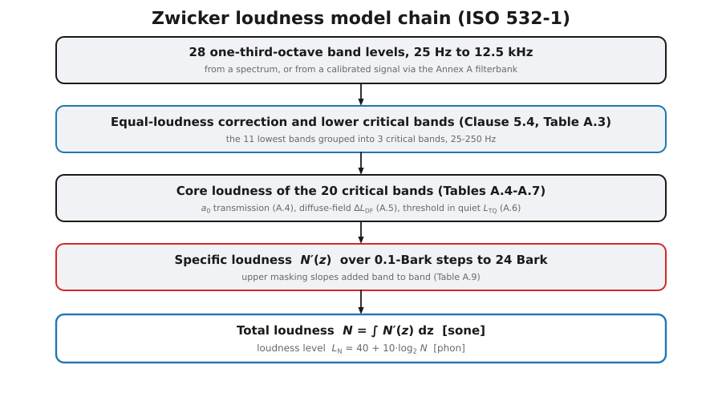
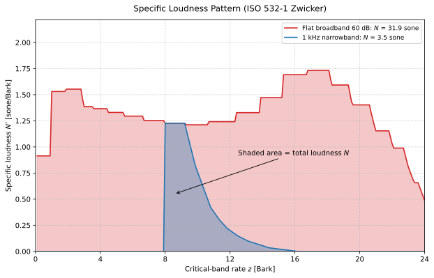
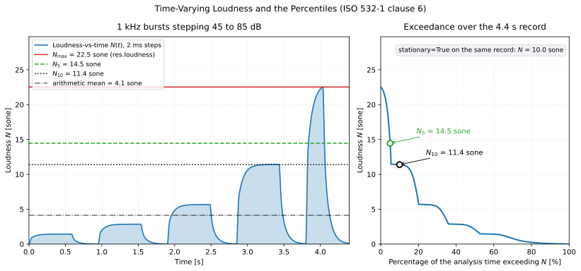
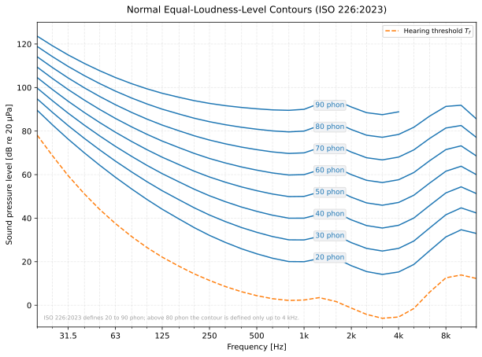

<!-- Written by `make llms` from site/src/content/docs/perception/psychoacoustics/loudness.mdx: edit that page and its Spanish twin, then run `make llms`. -->

← [Documentation index](../../README.md) · Published at https://phonometry.dev/perception/psychoacoustics/loudness/

# Loudness

Level metrics tell you how much *sound pressure* there is; loudness tells you
how loud a listener actually *perceives* it. This page covers the reference
method, loudness in sones by Zwicker (ISO 532-1), plus the equal-loudness
contours of pure tones (ISO 226); the newer model families, Moore-Glasberg
(ISO 532-2/-3) and the Sottek Hearing Model loudness (ECMA-418-2), are
[Advanced Loudness](advanced-loudness.md).
Sharpness, tonality and roughness live in
[Sound Quality Metrics](sound-quality.md); speech metrics in
[Speech Transmission Index](../speech/speech-transmission.md) and
[Speech Intelligibility Index](../speech/speech-intelligibility.md).

## How do I compute ISO 532-1 Zwicker loudness in Python?

Call `psychoacoustics.loudness_zwicker(x, fs, calibration_factor=sens)` on a
calibrated recording. If you only have a spectrum, use
`loudness_zwicker_from_spectrum(levels_28)` with the 28 one-third-octave band
levels from 25 Hz to 12.5 kHz. Either result carries `loudness_level` in phons
and `loudness` in sones (the single stationary $N$ with `stationary=True`,
the peak $N_\text{max}$ of the loudness trace otherwise), plus the reporting
percentiles `n5` and `n10` for a time-varying run.

## Loudness in sones (ISO 532-1, Zwicker)

Decibels compress perception: 10 dB more reads as *twice as loud*, and two
sounds with the same dB(A) can differ audibly depending on how their energy
spreads over the ear's **critical bands**. The Zwicker method models the
hearing chain explicitly (outer/middle-ear transmission, critical-band
analysis on the 24 Bark scale, level-dependent masking slopes) and outputs
**loudness $N$ in sones**, a ratio scale: 4 sones is twice as loud as 2 sones.
By definition a 1 kHz tone at 40 dB SPL is 1 sone, and every +10 phon
doubles the sone value.

<picture><source media="(prefers-color-scheme: dark)" srcset="https://raw.githubusercontent.com/jmrplens/phonometry/main/.github/images/diagram_zwicker_dark.svg"></picture>

The animation below shows that integration at work: as the band level of a
1 kHz narrowband sound steps up, the specific-loudness pattern $N'(z)$ grows
along the Bark axis and the area under it is the total loudness in sones.

**Video:** [How specific loudness integrates to total loudness](https://raw.githubusercontent.com/jmrplens/phonometry-assets/a6e56d3504d9485e4e0402fa87ad71260ed8d924/images/anim_specific_loudness.webm): The specific-loudness pattern of a 1 kHz narrowband sound builds along the Bark axis as the band level steps from 45 to 85 dB, and the area under the pattern integrates to the total loudness in sones.

### Measuring the input (clause 4)

Loudness is an absolute-level quantity: nothing in it cancels, so an
uncalibrated or A-weighted recording produces a plausible number that is simply
wrong, and the result carries no sign of it. ISO 532-1 therefore specifies the
input before it specifies the model.

**The chain.** A microphone, preamplifier and amplifier meeting
IEC 61672-1:2013 class 1, and a field calibration that turns digital units into
pascals: that factor is what `calibration_factor` expects, and
[Calibration](../../signals/metrology/calibration.md) is where it comes
from. Clause 4 fixes the sampling rate of the reference implementation at
48 kHz; other rates are resampled to it, which the library does internally.
For the band-level entry point, the 28 one-third-octave levels must come from
filters conforming to IEC 61260-1:2014 class 1 with centre frequencies from
25 Hz to 12.5 kHz.

**Two rules about the samples themselves.** No frequency weighting of any kind:
definition 3.2 Note 1 states that weightings such as A-weighting shall not be
used for loudness calculation, because the model applies the ear's own
weighting internally and an A-weighted input weights it twice. And true sound
pressure, not normalised or peak-scaled data (clause 4, "correct sound pressure
values, no normalized data"). The `sens = 1.0` in the snippets below is a
placeholder that keeps this page runnable, not a default worth keeping: get the
calibration wrong by 10 dB and the reported loudness doubles or halves
(13.1 sone becomes 26.6 or 6.5 on the example signal), which dwarfs every
difference between the models on the next page.

**Where the microphone goes.** Definition 3.19 Note 2 puts it at the point
where the centre of the listener's head would be, with the listener absent;
that is what makes the calculated loudness the loudness of a *diotic*
presentation, the same sound at both ears. The geometry drawn below is the
ECMA-74 bystander position (1.00 m from the reference box, 1.50 m above the
reflecting plane) because ISO 532-1 prescribes no distance of its own and
takes it from whichever emission standard applies.

<picture><source media="(prefers-color-scheme: dark)" srcset="https://raw.githubusercontent.com/jmrplens/phonometry/main/.github/images/diagram_loudness_capture_dark.svg"></picture>

*The three routes to a valid input. Panel A gives $N_\mathrm{F}$ and panel B $N_\mathrm{D}$; the
field type is part of the result, not a preference.*

**Which field, and why it must be stated.** `field="free"` applies the frontal
free-field transfer of the head and outer ear and suits a direct field:
anechoic room, close to a source, outdoors; `field="diffuse"` applies the
random-incidence transfer and suits a reverberant room or an in-situ
measurement. The correction is a fixed spectral shape applied to the band
levels before the critical-band stage, largest above 1 kHz where head
diffraction and ear-canal resonance differ most: on a flat 60 dB spectrum the
diffuse-field result is 33.9 sone against 31.9 sone free field (6 %), small
beside a calibration error, large enough to matter when two products are being
compared. Clause 4 requires the field type to be specified and clause 7 makes
it part of the report, so "N = 13.1 sone" is incomplete: write $N_\mathrm{F}$ or $N_\mathrm{D}$,
or say "free field" beside the number.

**Artificial-head recordings.** Annex D governs the head-and-torso route: the
recording must already carry an equalization matched to the measuring
environment (free-field only for a single frontal source beyond 1.5 m,
diffuse-field in reflective surroundings, ID equalization in vehicles) and
each ear channel is analysed separately, with both reported and the maximum or
the mean quoted as the single value.

**What the report has to contain** (clause 7): the sound assessed, a reference
to ISO 532-1, which method was used (stationary clause 5 or time-varying
clause 6), the sound field F or D, the type of input data (band levels or time
signal), the loudness in sones, and (for a time-varying run) the loudness
time function, with $N_\text{max}$ and $N_5$ where required.
`ZwickerLoudness.report()` prints the acoustic half of that list; the rest
arrives through `ReportMetadata`.

```python
import numpy as np
from phonometry import psychoacoustics

# A raw recording plus its calibration so the guide runs standalone
fs = 48000
x = 0.2 * np.sin(2 * np.pi * 1000 * np.arange(fs) / fs)   # any recording (digital units)
sens = 1.0                                                # calibration_factor to pascals
levels_28 = np.full(28, 60.0)                             # 28 one-third-octave band levels (dB)

# From a raw recording: calibration_factor scales digital units to Pa
res = psychoacoustics.loudness_zwicker(x, fs, field="free", calibration_factor=sens)
print(f"N = {res.loudness:.1f} sone  ({res.loudness_level:.0f} phon)")   # 13.1 sone (77 phon)

# Time-varying signals: percentile loudness N5 is the reporting standard.
# A 4.4 s train of 1 kHz bursts stepping 45 -> 85 dB, the loudest one brief.
segments = []
for level, seconds in [(45.0, 0.6), (55.0, 0.6), (65.0, 0.6), (75.0, 0.6), (85.0, 0.25)]:
    n = int(seconds * fs)
    k = np.arange(n)
    env = np.minimum(1.0, np.minimum(k, n - 1 - k) / (0.02 * fs))   # 20 ms ramps
    p = np.sqrt(2) * 2e-5 * 10 ** (level / 20)                      # peak amplitude (Pa)
    segments += [p * np.sin(2 * np.pi * 1000 * k / fs) * env, np.zeros(int(0.35 * fs))]
bursts = np.concatenate(segments)

tv = psychoacoustics.loudness_zwicker(bursts, fs)      # stationary=False (default)
print(f"{tv.n5:.1f} {tv.n10:.1f} {tv.loudness:.1f}")   # 14.5 11.4 22.5 — N5, N10, Nmax

# From 28 one-third-octave band levels (25 Hz .. 12.5 kHz)
res = psychoacoustics.loudness_zwicker_from_spectrum(levels_28, field="diffuse")

res.plot()   # N'(z) over the Bark scale — the specific-loudness pattern (needs matplotlib)
```

<picture><source media="(prefers-color-scheme: dark)" srcset="https://raw.githubusercontent.com/jmrplens/phonometry/main/.github/images/loudness_pattern_dark.svg"></picture>

*Same band level, very different loudness: energy spread over many critical
bands (red) sums to far more sones than the same level concentrated in one
band (blue). The area under $N'(z)$ is the total loudness.*

<details>
<summary>Show the code for this figure</summary>

```python
import matplotlib.pyplot as plt
import numpy as np
from phonometry import psychoacoustics

levels_28 = np.full(28, 60.0)                             # 28 one-third-octave band levels (dB)
# From 28 one-third-octave band levels (25 Hz .. 12.5 kHz)
res = psychoacoustics.loudness_zwicker_from_spectrum(levels_28, field="diffuse")

# One line — the specific-loudness pattern N'(z) straight from the result:
res.plot()
plt.show()

# Or reproduce the figure by hand — two patterns of equal band level (60 dB),
# energy spread over many critical bands vs concentrated in the 1 kHz band:
narrow = psychoacoustics.loudness_zwicker_from_spectrum(np.r_[np.full(16, -60.0), 60.0, np.full(11, -60.0)])
broad = psychoacoustics.loudness_zwicker_from_spectrum(np.full(28, 60.0))
z = np.arange(1, narrow.specific.size + 1) * 0.1          # Bark axis
fig, ax = plt.subplots()
for r, color, label in [
    (broad, "#d62728", f"Flat broadband 60 dB - N = {broad.loudness:.1f} sone"),
    (narrow, "#1f77b4", f"1 kHz narrowband - N = {narrow.loudness:.1f} sone"),
]:
    ax.fill_between(z, r.specific, color=color, alpha=0.3)
    ax.plot(z, r.specific, color=color, label=label)
ax.set_xlabel("Critical-band rate z [Bark]")
ax.set_ylabel("Specific loudness N' [sone/Bark]")
ax.legend()
plt.show()
```

</details>

The implementation is a clean-room port of the standard's **normative
reference program** (Annex A.4): all twelve data tables are digit-exact and
the full Annex B validation set runs in CI: the stationary test case
reproduces the published value to every printed digit, and the tone-pulse
$N(t)$ traces stay inside the standard's per-sample 5 % tolerance band.

### `loudness_zwicker()` parameters

| Parameter | Type | Units | Range / default | Notes |
| :--- | :--- | :--- | :--- | :--- |
| `x` | 1D array | Pa (after calibration) | ≥ 8 ms at 48 kHz | Resampled internally to 48 kHz if needed |
| `fs` | int | Hz | > 0 | |
| `field` | str | — | `'free'` (default) / `'diffuse'` | Sound-field correction (Table A.5) |
| `stationary` | bool | — | default `False` | `True`: single $N$ from the averaged spectrum |
| `calibration_factor` | float | Pa per digital unit | default `1.0` | From `sensitivity()` |

Returns a `ZwickerLoudness` dataclass: `loudness_level` (phon), `specific`
($N'(z)$, 240 bins of 0.1 Bark), and for time-varying runs `n5`, `n10`, `times`
and `loudness_vs_time` (500 Hz trace). `loudness` ($N$, sones) changes meaning
with `stationary`: with `stationary=True` it is the single stationary $N$ of
clause 5, and with the default `stationary=False` it is the peak
$N_\text{max}$ of the clause 6 loudness-versus-time trace (which is why the
first snippet above, run on a steady tone, already reports a maximum).

### Reading a time-varying result (clause 6.4)

A fluctuating sound has no single loudness, so ISO 532-1 clause 6.4 reports a
percentile: $N_5$, the loudness exceeded 5 % of the analysis time, because the
arithmetic mean of $N(t)$ sits systematically below what listeners judge: on
the burst train above the mean is 4.1 sone against $N_5 = 14.5$. $N_{10}$ is
the gentler companion for sounds with brief peaks, and `res.loudness` is
$N_\text{max}$: the right quantity for hunting the worst instant, the wrong one
to quote as "the loudness".

<picture><source media="(prefers-color-scheme: dark)" srcset="https://raw.githubusercontent.com/jmrplens/phonometry/main/.github/images/zwicker_time_varying_dark.svg"></picture>

*What a percentile of a loudness trace is. The brief 85 dB burst sets
$N_\text{max}$ and almost nothing else: it occupies under 6 % of the record, so
$N_5$ lands 8 sone below it. The same record analysed with `stationary=True`
returns 10.0 sone, a fifth quantity again.*

<details>
<summary>Show the code for this figure</summary>

```python
import matplotlib.pyplot as plt

# `bursts` and `tv` come from the snippet above.
plt.plot(tv.times, tv.loudness_vs_time, label="N(t)")
for value, label in [(tv.loudness, "Nmax"), (tv.n5, "N5"), (tv.n10, "N10")]:
    plt.axhline(value, linestyle="--", label=f"{label} = {value:.1f} sone")
plt.xlabel("Time [s]")
plt.ylabel("Loudness N [sone]")
plt.legend()
plt.show()
```

</details>

Because $N_5$ is a percentage of the analysis window, lengthening or shortening
the record moves it. Quote the measurement time beside $N_5$, keep it identical
across the sounds being compared (clause 6.4 requires as much), and do not use
$N_5$ for isolated impulses at all: that is exactly the case the trace above
caricatures. `loudness_vs_time` and `times` carry the trace, so a record can be
trimmed to the operating state of interest before the percentile is read, and
the measurement interval belongs in `ReportMetadata`, since the fiche prints
$N_5$ without one.

### Road pass-bys recorded by a class 1 meter

Every number above comes from a synthetic signal. The repository also keeps
five real road-traffic pass-bys, recorded by an NTi Audio XL2 sound level
meter 7.5 m from the lane centre during a statistical pass-by campaign of the
University of Antwerp. The deposit that publishes the campaign lists, for each
pass-by, the $L_\mathrm{A,eq}$, the $L_\mathrm{A,max}$, the $L_{10}$ and the
median loudness $N_{50}$ its authors computed with PsySound3 over a 4 s window
centred on the peak, and the five excerpts are five of those windows: the
deposit's four vehicle categories, with a van at 60 km/h and another at
90 km/h. So the same chain runs on them here: the A-weighted levels through
`signals`, the maximum from the A-weighted, Fast-weighted envelope (the
workbook does not name the time weighting; Fast reproduces every published
maximum and Slow misses by several decibels), and $N_{50}$ as the median of
the ISO 532-1 loudness trace, the percentile beside $N_5$ above. An excerpt is
a cut, not a file the meter wrote, so it carries no `bext` of its own: each one
is calibrated by the digital full scale its session's meter declared in the
recording it was cut from, 129.4 or 129.5 dB SPL;
[Reading and writing measurement audio](../../io/audio-files.md) reads a
declaration of the same kind, 129.3 dB SPL, off the meter's own calibration
take.

**The data.** Pass-by excerpts from A. Grangeiro de Barros and C. Vuye,
'Psychoacoustic indicators of pass-by road traffic noise', Zenodo, 2023, DOI
[10.5281/zenodo.7904680](https://doi.org/10.5281/zenodo.7904680), licensed
[CC BY 4.0](https://creativecommons.org/licenses/by/4.0/), recorded with an
NTi Audio XL2. Changes: 4-second extracts cut bit-exactly and recontainered.

The files are read from a checkout of the repository, where the oracle test
reads them too; a wheel does not install the test data.

```python
import pathlib

import numpy as np
import phonometry
from phonometry import filters, io, psychoacoustics, signals

# The committed excerpts live in the repository, so this runs from a checkout
#   (or an editable install); with your own meter's WAV files, pass their paths.
repo = pathlib.Path(phonometry.__file__).resolve().parents[2]
# Per excerpt: the full scale its session's meter declared (0 dBFS in dB SPL, in the
#   bext of the recording it was cut from), then the deposit's row:
#   LA,eq, LA,max and L10 in dB, N50 in sone.
pass_bys = {
    "passby_0566_van_60kmh.wav": (129.4, 73.905, 78.196, 77.358, 27.445),
    "passby_0571_van_90kmh.wav": (129.4, 76.928, 82.154, 81.522, 25.821),
    "passby_0668_passenger_car_74kmh.wav": (129.4, 75.546, 80.353, 79.525, 25.999),
    "passby_0960_heavy_dual_axle_66kmh.wav": (129.4, 80.600, 85.993, 85.114, 38.271),
    "passby_1558_heavy_multi_axle_62kmh.wav": (129.5, 77.537, 81.616, 81.090, 33.002),
}
level_gaps, loudness_gaps = [], []
for name, (full_scale_spl, *published) in pass_bys.items():
    take = io.read(repo / "tests/data/audio/xl2" / name)
    cal = 2e-5 * 10 ** (full_scale_spl / 20)   # what 0 dBFS is in pascals
    laeq = float(signals.laeq(take, calibration_factor=cal))
    # LA,max with Fast time weighting: the peak of the A-weighted, Fast-averaged square.
    a_fast = filters.time_weighting(filters.weighting_filter(np.asarray(take), take.fs, "A"),
                                    take.fs, mode="fast")
    lamax = 10 * np.log10(float(np.max(a_fast)) * cal**2 / 2e-5**2)
    l10 = float(signals.ln_levels(take, n=(10,), mode="fast", weighting="A",
                                  calibration_factor=cal)[10])
    # N50: the median of the ISO 532-1 loudness trace, exceeded half of the 4 s.
    n50 = float(np.median(psychoacoustics.loudness_zwicker(take, calibration_factor=cal).loudness_vs_time))
    level_gaps += [abs(a - b) for a, b in zip((laeq, lamax, l10), published[:3], strict=True)]
    loudness_gaps.append(100 * abs(n50 / published[3] - 1))
    print(f"{name[7:-4]}: LAeq {laeq:.1f} ({published[0]:.1f}), LAmax {lamax:.1f} ({published[1]:.1f}), "
          f"L10 {l10:.1f} ({published[2]:.1f}) dB, N50 {n50:.1f} ({published[3]:.1f}) sone")
# 0566_van_60kmh: LAeq 73.7 (73.9), LAmax 78.0 (78.2), L10 77.3 (77.4) dB, N50 28.2 (27.4) sone
# 0571_van_90kmh: LAeq 76.7 (76.9), LAmax 81.9 (82.2), L10 81.4 (81.5) dB, N50 26.6 (25.8) sone
# 0668_passenger_car_74kmh: LAeq 75.4 (75.5), LAmax 80.1 (80.4), L10 79.4 (79.5) dB, N50 26.6 (26.0) sone
# 0960_heavy_dual_axle_66kmh: LAeq 80.4 (80.6), LAmax 85.8 (86.0), L10 85.1 (85.1) dB, N50 39.5 (38.3) sone
# 1558_heavy_multi_axle_62kmh: LAeq 77.4 (77.5), LAmax 81.5 (81.6), L10 81.0 (81.1) dB, N50 34.1 (33.0) sone
print(f"Largest gap: {max(level_gaps):.2f} dB in a level, {max(loudness_gaps):.1f} % in N50")  # Largest gap: 0.23 dB in a level, 3.4 % in N50
```

Each line gives the computed value with the published one in brackets. The
three levels land within 0.23 dB of the workbook and $N_{50}$ within 3.4 %,
inside the 0.3 dB and 5 % that
[the test](https://github.com/jmrplens/phonometry/blob/main/tests/signals/test_xl2_passby_oracle.py)
holds them to. The levels come out a little below the published ones and
$N_{50}$ a little above, a small systematic offset between two
implementations of the same chain, and 5 % is the width of the per-sample
tolerance band ISO 532-1 puts around its own reference loudness traces. Two
published columns are left out on purpose, $L_{90}$ and $\Delta L$: both depend
on where the Fast envelope starts relative to the 4 s window, so they would
pin a windowing convention, not a measurement.

### ISO 532-1 report (`.report()`)

`ZwickerLoudness.report(path)` renders a one-page PDF fiche laid out like an
accredited loudness report: a standard-basis line, an optional metadata header
block, a compact metrics table (total loudness $N$, loudness level $L_\mathrm{N}$,
and the $N_5$/$N_{10}$ percentiles for a time-varying result)
beside the specific-loudness pattern $N'(z)$ (the result's own `.plot()`), the
boxed $N = X\ \text{sone}$ ($L_\mathrm{N} = Y\ \text{phon}$) single number, an optional
verdict row and a
footer with the fixed disclaimer. It uses the same `ReportMetadata` container
and rendering engine as the [ISO 717 insulation fiche](../../buildings/insulation/insulation-ratings.md#iso-717-report-report);
a supplied `requirement` is read as the maximum permitted loudness in sone (a
lower loudness passes). Rendering needs reportlab and, for the figure the fiche
embeds, matplotlib (`pip install "phonometry[report,plot]"`); only
`engine="reportlab"` is supported. The fiche renders in English by default; pass
`language="es"` for a Spanish fiche (translated fixed strings and a comma
decimal separator), e.g. `res.report("loudness_fiche_es.pdf", language="es")`.

```python
from phonometry import psychoacoustics, ReportMetadata

res = psychoacoustics.loudness_zwicker_from_spectrum(levels_28, field="free")
res.report(
    "loudness_fiche.pdf",
    metadata=ReportMetadata(
        specimen="Household appliance, steady operating noise",
        measurement_standard="ISO 532-1 method 1",
        laboratory="Phonometry Reference Laboratory",
        requirement=12.0,             # maximum permitted loudness (sone)
    ),
)                                     # N (sone) and LN (phon)
```

The example fiche is regenerated with `make reports` and kept rendered in the
repository; click the preview to open the PDF.

[](https://raw.githubusercontent.com/jmrplens/phonometry/main/.github/reports/iso532_loudness_example.pdf)

Zwicker loudness fiche (ZwickerLoudness.report), N in sone with LN in phon.

## Loudness level of pure tones (ISO 226:2023)

The normal equal-loudness-level contours relate the SPL of a pure tone to its
perceived *loudness level* in phons (the SPL of an equally loud 1 kHz tone).
`equal_loudness_contour(phon)` evaluates ISO 226:2023 Formula (1) at the 29
preferred third-octave frequencies of Table 1, `loudness_level(spl, frequency)`
is the exact inverse (Formula 2), and `hearing_threshold()` returns the
threshold-of-hearing column. `equal_loudness_contours(phons)` bundles a whole
family of contours with the threshold into a plottable `EqualLoudnessContours`
result:

```python
from phonometry import psychoacoustics

contour = psychoacoustics.equal_loudness_contour(40.0)
freqs, spl = contour.frequencies, contour.levels   # the classic 40-phon contour
phon = psychoacoustics.loudness_level(73.0, 63.0)           # 73 dB @ 63 Hz -> 40 phon

# The whole family (20-90 phon by default) plus the hearing threshold:
res = psychoacoustics.equal_loudness_contours()
res.plot()   # the iconic ISO 226 chart (needs matplotlib)
```

<picture><source media="(prefers-color-scheme: dark)" srcset="https://raw.githubusercontent.com/jmrplens/phonometry/main/.github/images/equal_loudness_contours_dark.svg"></picture>

ISO 226:2023 defines the contours from 20 to 90 phon; above 80 phon the formula is valid only up to 4 kHz, so the 90 phon contour stops there and no higher contours are defined.

<details>
<summary>Show the code for this figure</summary>

```python
import matplotlib.pyplot as plt
from phonometry import psychoacoustics

# One line — the contour family straight from the result:
res = psychoacoustics.equal_loudness_contours()
res.plot()
plt.show()

# Or reproduce the figure by hand — ISO 226:2023 Formula (1) at the 29
# preferred frequencies of Table 1, one contour per loudness level:
fig, ax = plt.subplots()
for phon in [20, 40, 60, 80, 90]:
    contour = psychoacoustics.equal_loudness_contour(float(phon))
    freqs, spl = contour.frequencies, contour.levels
    ax.semilogx(freqs, spl, color="C0")
    ax.annotate(f"{phon} phon", xy=(1000, phon + 1), fontsize=9)
threshold = psychoacoustics.hearing_threshold()
ft, tf = threshold.frequencies, threshold.levels
ax.semilogx(ft, tf, "--", color="C1", label="Hearing threshold $T_f$")
ax.set(xlabel="Frequency [Hz]", ylabel="Sound pressure level [dB re 20 µPa]")
ax.grid(True, which="both", alpha=0.3)
ax.legend()
plt.show()
```

</details>

Validity per clause 4.1: 20-90 phon (80 phon above 4 kHz); the implementation
is verified against the Annex B tables in CI. Note this is the loudness of
*pure tones*; the loudness of arbitrary signals in sones is what the ISO 532
models compute, the Zwicker method above and the newer families of
[Advanced Loudness](advanced-loudness.md).

Zwicker is the reference model, not the only one. The **Moore-Glasberg**
loudness of ISO 532-2, its time-varying ISO 532-3 extension and the
**Sottek Hearing Model** loudness of ECMA-418-2, together with the
model-choice table that says when to prefer each, are
[Advanced Loudness](advanced-loudness.md).

## What this guide covers

- **Covered.** ISO 532-1:2017 (Zwicker method): the clause 4 input and instrumentation
  requirements, the stationary method of clause 5 and the time-varying method of
  clause 6 with the clause 6.4 percentile rules, ported from the normative Annex
  A.4 reference program and validated against Annex B, with the `n5`/`n10`
  percentiles, via `loudness_zwicker()` and `loudness_zwicker_from_spectrum()`;
  the clause 7 reporting list and the Annex D guidance for head-and-torso
  recordings. ISO 226:2023: Formula (1), Formula (2) and the Table 1 contour
  parameters, via `equal_loudness_contour()`, `loudness_level()`,
  `hearing_threshold()` and `equal_loudness_contours()`.

- **Not covered.** The Moore-Glasberg loudness of ISO 532-2, the time-varying ISO 532-3 method
  and the Sottek Hearing Model loudness of ECMA-418-2 have moved to [Advanced
  Loudness](advanced-loudness.md). The ISO
  226:2023 contours describe pure tones only, and the standard defines no
  interpolation between the 29 tabulated frequencies, so `loudness_level()`
  expects one of the Table 1 frequencies.

## See also

- [Advanced Loudness (ISO 532-2/-3, ECMA-418-2)](advanced-loudness.md):
  the Moore-Glasberg and Sottek loudness models and the model-choice table.
- [Sound Quality Metrics](sound-quality.md): sharpness,
  tonality and roughness, the other half of the sound-quality story.
- [Psychoacoustic annoyance and fluctuation strength](psychoacoustic-annoyance.md):
  the Zwicker and Fastl model that consumes the percentile loudness $N_5$.
- [Theory](../../reference/theory/perception.md): the equations behind the loudness models.
- API reference: [`psychoacoustics.loudness.zwicker`](https://phonometry.dev/reference/api/psychoacoustics/zwicker/) and [`psychoacoustics.loudness.contours`](https://phonometry.dev/reference/api/psychoacoustics/contours/).
- Theory: [Zwicker loudness (ISO 532-1)](../../reference/theory/perception.md#zwicker-loudness-iso-532-1): the specific-loudness integral of ISO 532-1 and the excitation pattern it runs over.

## Quick answers

### What is the difference between loudness in sones and loudness level in phons?

Loudness $N$ in sones (ISO 532-1) is a ratio scale of perceived loudness: 4 sones is twice as loud as 2 sones, and by definition a 1 kHz tone at 40 dB SPL is 1 sone. Loudness level in phons (ISO 226) is the SPL of an equally loud 1 kHz pure tone, and every +10 phon doubles the sone value.

### Over what range are the ISO 226:2023 equal-loudness contours valid?

ISO 226:2023 clause 4.1 defines the normal equal-loudness-level contours from 20 to 90 phon, evaluated at the 29 preferred third-octave frequencies of Table 1; above 80 phon the formula is valid only up to 4 kHz, so the 90 phon contour stops there and no higher contours are defined. The contours describe pure tones, not arbitrary signals.

## References

- **Fastl, H., & Zwicker, E. (2007).** *Psychoacoustics: Facts and models* (3rd ed.). Springer. https://doi.org/10.1007/978-3-540-68888-4
  The critical-band and masking psychoacoustics behind the Zwicker model.
- **Fletcher, H., & Munson, W. A. (1933).** Loudness, its definition, measurement and calculation. *The Journal of the Acoustical Society of America*, *5*(2), 82-108. https://doi.org/10.1121/1.1915637
  The original equal-loudness measurements behind the loudness-level concept of the pure-tone section.
- **Grangeiro de Barros, A., & Vuye, C. (2023).** [*Psychoacoustic indicators of pass-by road traffic noise*](https://zenodo.org/records/7904680) \[Data set\]. Zenodo. https://doi.org/10.5281/zenodo.7904680
  The road pass-bys of the worked case: five 4 s excerpts recorded by an NTi Audio XL2, and the levels and N50 its authors published for each.
- **International Organization for Standardization. (2017).** [*Acoustics — Methods for calculating loudness — Part 1: Zwicker method*](https://www.iso.org/standard/63077.html) (ISO 532-1:2017).
  Stationary and time-varying loudness in sones from the normative Annex A.4 reference program, with the N5/N10 percentile loudness, validated against the Annex B set.
- **International Organization for Standardization. (2023).** [*Acoustics — Normal equal-loudness-level contours*](https://www.iso.org/standard/83117.html) (ISO 226:2023).
  The contour model and Table 1 parameters behind the pure-tone loudness levels: the contours (Formula 1), the loudness level of pure tones (Formula 2) and the hearing threshold.
