<!-- Written by `make llms` from site/src/content/docs/reference/theory/rooms-buildings.mdx: edit that page and its Spanish twin, then run `make llms`. -->

← [Documentation index](../../README.md) · Published at https://docs.jmrp.io/phonometry/reference/theory/rooms-buildings/

# Theory: Rooms and Buildings

This page collects the theory behind rooms and buildings: impulse-response measurement and the room-acoustic parameters, the image-source and steady-state models of the sound field in a room, background-noise criteria, airborne and impact insulation with their single-number ratings and uncertainty, and flanking and absorption prediction. It is part of the [theory reference](index.md); surface scattering and acoustic material characterisation live on [Materials and Surfaces](materials-surfaces.md).

Each section keeps its own standard's notation, and five letters carry more than
one meaning across them:

| Symbol | Meaning | Where |
| :--- | :--- | :--- |
| $A$ | Equivalent absorption area, m² ($A_0 = 10$ m² reference, $A_\mathrm{T}$ specimen, $A_\mathrm{obj}$, $A_\mathrm{air}$) | throughout |
| $m$ | Power attenuation coefficient of air, 1/m | image sources, ISO 354 and EN 12354-6 |
| $m$ | Number of repeated measurements | ISO 12999-1 uncertainty only |
| $m'$ / $m''$ | Mass per unit area, kg/m² (EN 12354 writes $m'$, the panel-prediction literature $m''$) | flanking and panel prediction |
| $C$ | Clarity, dB (subscripted 50 or 80) | ISO 3382-1 parameters |
| $C$ | Decay curvature, % | ISO 3382-2 validity |
| $C$, $C_\mathrm{tr}$ | Spectrum adaptation terms, dB | ISO 717 ratings |
| $R$ | Room constant, m² | steady-state room field |
| $R_q$ | Pressure reflection factor of wall $q$ | image sources |
| $R$, $R'$ | Sound reduction index, dB ($R_\mathrm{w}$ weighted, $R'$ apparent) | insulation sections |
| $T$ | Reverberation time, s ($T_\mathrm{S}$ is the centre time) | throughout |

## Room noise criteria (ANSI S12.2)

ANSI/ASA S12.2-2019 rates steady background noise in rooms against families of octave-band curves (16 Hz – 8 kHz). The **NC rating** starts from the speech interference level $\mathrm{SIL} = \tfrac14(L_{500}+L_{1000}+L_{2000}+L_{4000})$ (clause 3.2), which preselects the NC-(SIL) curve: if no band exceeds it, the spectrum is designated NC-(SIL) and the procedure ends there (clause 5.2.2). The two families otherwise differ in almost every respect:

| | NC | RC Mark II |
| :--- | :--- | :--- |
| Curve family | Table 1 curves NC-15 to NC-70, 16 Hz – 8 kHz | A pure −5 dB/octave line keyed to its 1 kHz value, floored at $\max(\mathrm{RC}+25,\ 55)$ dB at 16 and 31.5 Hz (Annex D) |
| How the rating is picked | Tangency (clause 5.2.3): each band interpolated against the tabulated curves, the highest per-band index wins | Arithmetic mean of the 500/1000/2000 Hz levels, rounded to an integer (D.4) |
| What is reported | A continuous value plus the band that set it (e.g. NC-42.5 at 250 Hz, not snapped to a curve) | An integer with a spectral-quality tag, e.g. RC-35(N) |
| Quality tag | none | Rumble "R" when any band ≤ 500 Hz exceeds the contour by more than 5 dB, hiss "H" when any band ≥ 1 kHz exceeds it by more than 3 dB, "RH" for both, else "N" (D.3) |
| Outside the family | Flagged: &gt;NC-70 with the band of maximum exceedance, or &lt;NC-15, rather than a fabricated number | — |

The generated RC contours reproduce Table D.1 digit for digit, and feeding any Table 1 NC curve back returns its own tangency rating. NCB, RNC (Annex A) and the QAI (clause D.5) are deliberately out of scope.

**Reading a rating.** Neither number is a verdict on its own; the criterion comes
from the use of the room, and Annex C (informative) is where the standard puts
it. Its Table C.2 recommends, for example, NC 25-30 for a classroom or a small
auditorium, 30-35 for a small private office, 40-45 for an open-plan area and
40-50 for public circulation. A rating in the low forties is unremarkable in
an open office and a clear failure in a lecture room. The RC tag is a diagnosis
rather than a grade: the reference contour is a straight −5 dB/octave line
because that is the slope occupants describe as bland, so **R** means the
spectrum carries more low-frequency energy than that slope allows and points at
fan and duct-borne noise or a structure-borne path, while **H** points at the
terminal device: diffuser velocity, turbulence at the outlet. Different tags,
different remedies. And a rating computed from a spectrum whose lowest bands were
never actually measured is not comparable with one where they were, because those
bands set both the tag and, often, the tangency point.

See the [Room Noise guide](../../buildings/rooms/room-noise.md) for usage.

<picture><source media="(prefers-color-scheme: dark)" srcset="https://raw.githubusercontent.com/jmrplens/phonometry/main/.github/images/room_noise_criteria_dark.svg">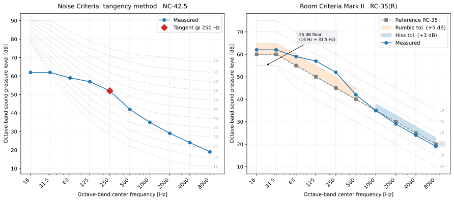</picture>

*One ventilation-dominated spectrum, read by both procedures. The NC rating is
set at 250 Hz (not at any of the four SIL bands) so the governing band is
already telling the diagnostic story, and NC-42.5 would pass in an open-plan
area and fail in a lecture room. The RC panel says the same thing in one letter:
the bands below 500 Hz push through the +5 dB rumble tolerance, so the room is
RC-35(R) and the remedy is on the low-frequency side, in the fan and the duct
run, not at the diffuser.*

## Impulse response and room-acoustic parameters (ISO 18233, ISO 3382-1/-2/-3)

### Deterministic-excitation impulse response (ISO 18233)

A room/transmission path is modelled as **linear time-invariant**, so its impulse response $h(t)$ carries everything. ISO 18233 replaces the classical noise-burst decay with a deterministic excitation that is **deconvolved** into $h(t)$, gaining 20–30 dB of effective signal-to-noise ratio. The exponential sine sweep (ESS, Annex B) has instantaneous frequency $f(t) = f_1 (f_2/f_1)^{t/T}$, so its phase is the closed-form integral of $2 \pi f(t)$:

$$
\varphi(t) = \frac{2 \pi f_1 T}{\ln(f_2/f_1)} \left[ \left( \frac{f_2}{f_1} \right)^{t/T} - 1 \right] .
$$

A constant time-per-octave makes the ESS spectrum pink (−3 dB/octave). Deconvolution is done by **linear** (non-circular, zero-padded) spectral division $H = Y\ \overline{X} / (|X|^2 + \varepsilon)$, the Tikhonov term $\varepsilon$ (a fraction of $\max |X|^2$) preventing noise blow-up at the band edges. Since a low-to-high sweep places harmonic-distortion products at negative arrival times, they fall in the wrapped tail and are removed by keeping the causal part (Farina). The MLS method (Annex A) instead exploits that the circular autocorrelation of a maximum-length sequence of length $2^N-1$ is a periodic delta, so $h = \operatorname{xcorr}_{\text{circ}}(\text{recorded}, \text{mls}) / 2^N$; synchronous averaging of $n$ periods adds $10 \log_{10} n$ dB.

**How long the record has to be, and what breaks first.** The two rules that
decide whether a deconvolved impulse response is usable are in clause 6.2, and
they differ by excitation type. A *repetitive* signal such as an MLS must have a
repetition period no shorter than the reverberation time of the room,
$T_\mathrm{REP} \ge T$ (Formula 10), or the modes are not excited to steady state and
the response wraps onto itself. A *non-repetitive* sweep may be of any suitable
length, but it must be **followed by silence**, and the decay must be recorded
over at least half the reverberation time (6.2.2.3); for a low-to-high sweep the
silence needed is set by the reverberation time at the *high* frequencies, which
is where padding has to be kept clear of the wrapped harmonic arrivals. A record
that stops with the sweep folds the tail back onto the head and biases every
$T$ and every clarity value derived from it, silently and always in the same
direction.

The diagram below sizes both excitations for a room with $T = 1.2$ s. For the
sweep, Annex B (B.3.1) considers a length of two to four times the longest
reverberation time, followed by a silent gap equal to that time, normally safe
under moderate background noise, and doubling the sweep duration normally adds
3 dB of effective signal-to-noise ratio (B.6). For the MLS, the period of an
order-$N$ sequence is $(2^N - 1)/f_\mathrm{s}$: at 48 kHz, order 17 lasts 2.73 s
and satisfies Formula 10, while order 15 lasts 0.68 s and does not. Annex A
takes the sequence as replayed periodically (A.2), and the room answers
periodically only once a whole period has run through it, so in practice the
first period played is discarded and the second is kept; that step is
measurement practice, which the standard does not state. The third lane is what the deconvolution of the sweep
returns, the linear response at time zero and the harmonic packets ahead of it.

<picture><source media="(prefers-color-scheme: dark)" srcset="https://raw.githubusercontent.com/jmrplens/phonometry/main/.github/images/diagram_sweep_budget_dark.svg"></picture>

The assumption that breaks first is time invariance, and clause 6.1 is explicit
about it: moving the source or a microphone during the measurement is not
acceptable, and neither air movement nor a change in the speed of sound through
temperature is. The path length changes by a fraction of a wavelength between
the start and the end of the excitation, and the deconvolution charges the
mismatch to the noise floor. This is also what separates the two methods in
practice: MLS rests on the exactness of the circular autocorrelation and
degrades under both time variance and loudspeaker distortion, which it smears
over the whole response, whereas the sweep pushes distortion products to
negative times where they can be cut away. The sweep is therefore the default,
and MLS is kept for cases where the excitation must be noise-like.

### Schroeder backward integration (ISO 3382-1, 5.3.3)

The band decay curve is the **backward-integrated** squared IR (Schroeder):

$$
E(t) = \int_t^{\infty} p^2(\tau)\ d\tau = \int_0^{\infty} p^2\ d\tau - \int_0^t p^2\ d\tau , \qquad L(t) = 10 \log_{10} \frac{E(t)}{E(0)}\ \text{dB},
$$

i.e. a reversed cumulative sum in discrete time. Backward integration cancels the random fluctuation of a single squared IR: for a purely exponential energy decay $p^2(t) = \mathrm{e}^{-a t}$ it gives $E(t) = \mathrm{e}^{-a t}/a$, an exactly straight line $L(t) = -(10 a / \ln 10)\ t$. Background noise flattens $E(t)$, so integration is truncated at the crossing $t_1$ of the fitted decay line with the noise level and the missing tail is compensated by an exponential with the fitted rate; without that term the finite integral systematically **underestimates** $T$.

The clip runs that reversed sum: the tail energy fills from the end of the
record while the decay curve is drawn toward $t = 0$, and the T20 and T30
regression lines of the next subsection close it.

**Video:** [Schroeder backward integration of the squared impulse response](https://raw.githubusercontent.com/jmrplens/phonometry-assets/121efdf58a806512db6b3ce160760f280e642f53/images/anim_schroeder.webm): The tail energy of the squared impulse response fills from the end while the backward integral advances toward t = 0, and the Schroeder decay curve emerges on a companion axis, ending with the T20 and T30 regression lines.

<picture><source media="(prefers-color-scheme: dark)" srcset="https://raw.githubusercontent.com/jmrplens/phonometry/main/.github/images/schroeder_decay_dark.webp">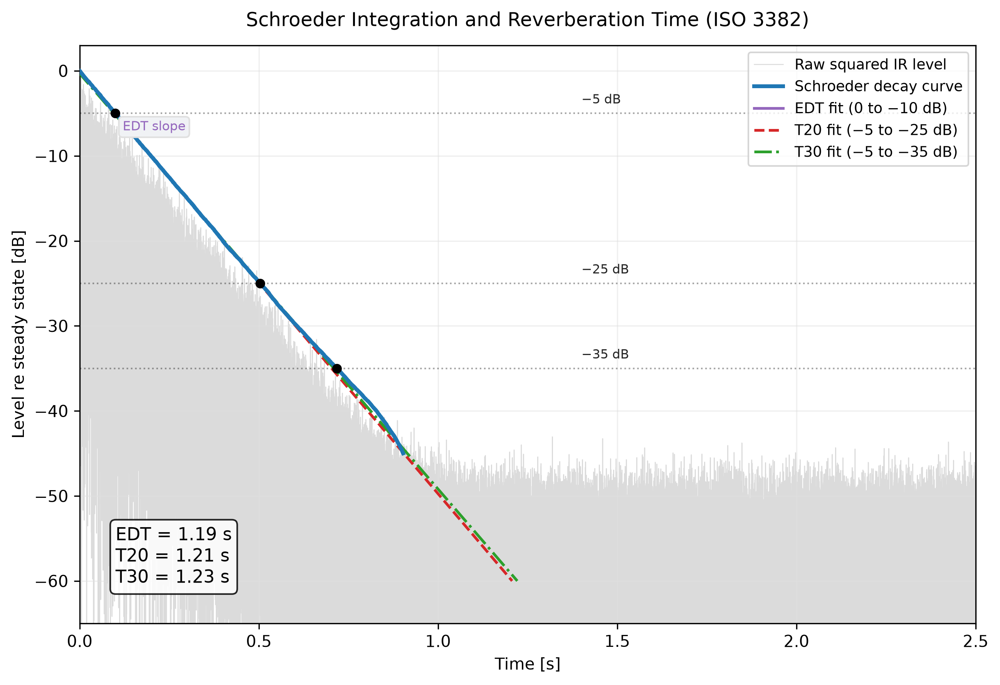</picture>

*A squared impulse response, its Schroeder backward integral and the EDT/T20/T30 regression windows of the next subsection.*

### Regression windows and validity (ISO 3382-2, Clause 6, Annex B/C)

Reverberation time is a least-squares fit $L = a + b t$ over a window, extrapolated to 60 dB via $T = -60/b$ (Annex C): **EDT** on 0 to −10 dB, **T20** on −5 to −25 dB, **T30** on −5 to −35 dB. A single-slope decay gives EDT = T20 = T30; a fast early / slow late double slope gives EDT < T30. Validity uses the dynamic-range rule of 5.3.3: the noise must sit at least 25 dB below the IR peak for EDT (evaluation span + 15 dB), tightened to 46 dB for T20 and 54 dB for T30 so the tail-compensation bias of a flagged-valid value stays within the 5 % JND. The **curvature** $C = 100\ (T_{30}/T_{20} - 1)$ % (Annex B) flags a non-straight decay above 10 %.

The regression is only half of what makes $T$ a property of the room rather than
of one point in it; the other half is spatial sampling, and ISO 3382-2 grades the
result by it (clause 4.3, Table 1). The **survey** method needs at least one
source position and two source-microphone combinations, one decay each, in
octave bands only, for a nominal accuracy better than 10 %. The **engineering**
method needs at least two source positions and **six** independent combinations
with two decays each, and is the grade the sound-insulation standards call for
(better than 5 % in octaves, 10 % in thirds). The **precision** method needs two
source positions and **twelve** combinations with three decays each (2.5 % and
5 %). Independence is the operative word: microphone positions should be about
half a wavelength apart, in practice a minimum of some 2 m, at least about a
quarter wavelength (roughly 1 m) from any reflecting surface including the
floor, never symmetric, and no closer to a source than
$d_{\min} = 2\sqrt{V/(c\,T)}$, so that direct sound does not dominate the early
decay. Positions packed closer than that are not the independent positions
Table 1 counts, and a $T$ averaged over them carries no grade at all.

The diagram below draws those rules on a room of 10 m by 6 m, 3.5 m high, for
which $V = 210$ m³ and an expected $T$ of 0.6 s give $d_{\min} = 2.0$ m. It adds
the two heights of ISO 3382-1 (clause 4.3): the acoustic centre of the source
1.5 m above the floor and, in rooms for speech and music, the microphones at
1.2 m, the ear height of a seated listener.

<picture><source media="(prefers-color-scheme: dark)" srcset="https://raw.githubusercontent.com/jmrplens/phonometry/main/.github/images/diagram_room_measurement_dark.svg">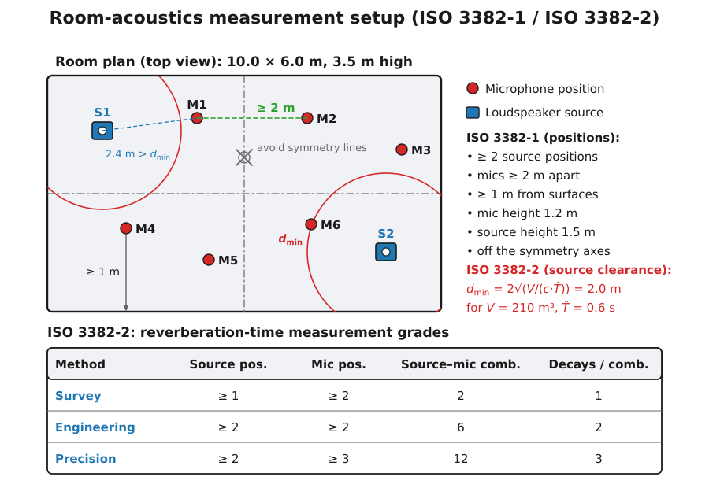</picture>

### Clarity, definition and centre time (ISO 3382-1, Annex A)

Splitting the energy at an early/late boundary $t_\mathrm{e}$ gives the early-to-late index and the definition ratio:

$$
C_{t_\mathrm{e}} = 10 \log_{10} \frac{\int_0^{t_\mathrm{e}} p^2\ dt}{\int_{t_\mathrm{e}}^{\infty} p^2\ dt}\ \text{dB}, \qquad D_{50} = \frac{\int_0^{0.05} p^2\ dt}{\int_0^{\infty} p^2\ dt}, \qquad C_{50} = 10 \log_{10} \frac{D_{50}}{1 - D_{50}},
$$

with $t_\mathrm{e} = 50$ ms (C50, speech) or 80 ms (C80, music), and the **centre time** $T_\mathrm{S} = \int_0^{\infty} t\ p^2\ dt / \int_0^{\infty} p^2\ dt$. For a pure exponential decay these have closed forms $C_{t_\mathrm{e}} = 10 \log_{10}(\mathrm{e}^{a t_\mathrm{e}} - 1)$ and $T_\mathrm{S} = 1/a$; at $T = 1$ s ($a = 13.8155$) they evaluate to C80 = 3.05 dB, C50 = −0.02 dB, D50 = 0.499 and Ts = 72.4 ms, the values the implementation reproduces. Table A.1 JNDs (EDT 5 %, C80 1 dB, D50 0.05, Ts 10 ms) bound how finely each is worth reporting.

<picture><source media="(prefers-color-scheme: dark)" srcset="https://raw.githubusercontent.com/jmrplens/phonometry/main/.github/images/room_parameters_bands_dark.svg">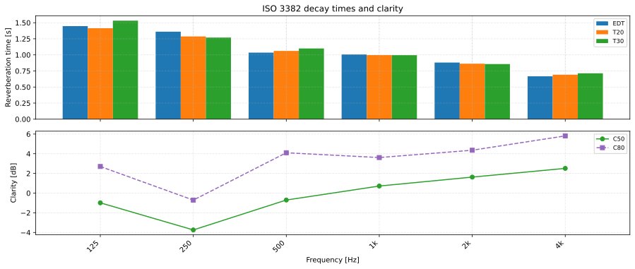</picture>

*The closed forms above hold for a single exponential decay; a real room gives
one set of values per band. The upper panel is the decay itself (EDT, T20 and
T30 falling with frequency as air and surfaces absorb more), the lower panel
the early/late split of the same impulse response, and C50 and C80 rise with
frequency for the same reason the decay time falls: the later the energy, the
more of it the room has already removed.*

### Open-plan spatial decay (ISO 3382-3, Clause 6)

The spatial decay rate of A-weighted speech is the ordinary least-squares slope of $L_{p,\mathrm{A,S}}$ against $\log_{10}(r/r_0)$ ($r_0 = 1$ m) over the 2–16 m positions, rescaled to a per-doubling figure, and the nominal level is read off the same line at 4 m:

$$
L = a + b\ \log_{10}(r/r_0), \qquad D_{2,\mathrm{S}} = -\log_{10}(2)\ b, \qquad L_{p,\mathrm{A,S},4\,\mathrm{m}} = a + b\ \log_{10}(4/r_0).
$$

The distraction distance rD and privacy distance rP are the distances where a **linear** (not logarithmic) regression of STI against distance crosses 0.50 and 0.20; a fitted slope that does not fall (STI not decreasing with distance; a constant STI fits to a slope a few units in the last place either side of zero, read as no decrease) makes them undefined, realising the standard's "can prove impossible to determine" note.

<picture><source media="(prefers-color-scheme: dark)" srcset="https://raw.githubusercontent.com/jmrplens/phonometry/main/.github/images/open_plan_decay_dark.svg">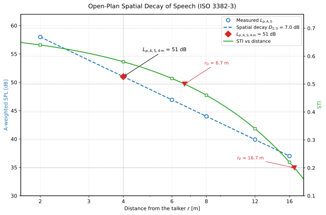</picture>

*Two regressions on two different axes, which is what makes this clause hard to
hold in the head. The level line is fitted against $\log_{10}(r/r_0)$ and read
twice, as the slope $D_{2,\mathrm{S}}$ per doubling, and at $r = 4$ m for
$L_{p,\mathrm{A,S},4\,\mathrm{m}}$. The STI line is fitted against $r$ itself, **linearly**,
and read where it crosses 0.50 and 0.20 for the distraction and privacy
distances. If that second fit comes out flat or rising, the two distances do
not exist rather than being large.*

<a id="room-sound-field-predicted-kuttruff-vorlander-bies"></a>

## Room sound field, predicted (Kuttruff, Vorländer, Bies)

<a id="image-source-room-impulse-response-kuttruff-41-vorlander-11"></a>

### Image-source room impulse response (Kuttruff 4.1, Vorländer 11)

A rectangular room reflects a point source in its walls; each reflection equals the free-field sound of a **mirror image** of the source. Mirroring the source position $S$ in a wall at distance $d$ with unit normal $\mathbf{n}$ ($S_n = S - 2 d\,\mathbf{n}$, Vorländer Eq. 11.36) turns the source into a regular lattice of images, and the room impulse response is the sum of the direct sound and one delayed, attenuated impulse per image (Kuttruff Eqs. 4.4–4.5),

$$
g(t) = \sum_n A_n\ \delta(t - t_n), \qquad
A_n = \frac{1}{4\pi r_n}\ \mathrm{e}^{-m r_n / 2} \prod_{\text{walls}} R_q^{\,k_{q,n}}, \qquad
t_n = \frac{r_n}{c},
$$

with the $1/(4\pi r_n)$ spherical spreading, the product of the wall **pressure reflection factors** $R_q = \sqrt{1 - \alpha_q}$ (Vorländer Eq. 11.39; $|R|^2 = 1-\alpha$ in energy) each raised to the number of reflections $k_{q,n}$ that image made off wall $q$, and the air pressure attenuation $\mathrm{e}^{-m r_n/2}$ ($m$ the power attenuation coefficient of the table above, so the intensity falls as $\mathrm{e}^{-m r}$ and the pressure as $\mathrm{e}^{-m r/2}$). Along one axis the reflection counts of the image at lattice index $n$ and parity $p$ are $|n-p|$ and $|n|$ off the two walls (Allen & Berkley 1979), so the total order is $\sum_i |2 n_i - p_i|$; a shoebox has $\tfrac{2}{3}(2 i_0^3 + 3 i_0^2 + 4 i_0)$ audible images up to order $i_0$ (Kuttruff Eq. 9.23), and the reflection density grows as $\mathrm{d}N/\mathrm{d}t = 4\pi c^3 t^2 / V$ (Kuttruff Eq. 4.6).

Integrated from $t = 0$, that density is a count: the sphere of radius $ct$
about the receiver holds $N(t) = \tfrac{4\pi}{3}(ct)^3/V$ images, one per room
volume. The clip sweeps that sphere over the lattice of a room of 7 m by 5 m,
3 m high, and counts the arrivals against the law:

**Video:** [A sphere expanding from the receiver sweeping the mirror-room lattice](https://raw.githubusercontent.com/jmrplens/phonometry-assets/121efdf58a806512db6b3ce160760f280e642f53/images/anim_image_source_buildup.webm): On the left, the 7 by 5 metre room sits at the centre of its grid of dashed mirror rooms, with the source as a star and the receiver as a triangle. A circle expands from the receiver at the speed of sound; as it reaches each image source that image lights up in its reflection-order colour and draws a straight line back to the receiver. On the right, the reflectogram fills in at the same instant: each image the circle reaches writes one stem at its arrival time and its level relative to the direct sound, under the dashed one-over-r spreading envelope. Below it a running count of arrivals climbs alongside the dashed analytic law, the two staying together as the count passes 44 at 30 milliseconds, 108 at 40, 202 at 50 and 344 at 60, where the law reads 348.

The echogram is a lattice being swept, not a decaying signal. Because the expanding sphere gains volume as the cube of time while the images are spaced one per room volume, arrivals accumulate as the cube of time and their rate grows as its square: the early discrete reflections and the late diffuse tail are the same construction read at two densities.

The initial decay rate of the specular reverberant energy recovers the **Eyring** reverberation time $T = -24 V \ln 10 / (c S \ln(1 - \bar\alpha))$ (Kuttruff Eq. 5.23), with $S$ here the total boundary area, because the mean reflection rate $cS/4V$ equals $\tfrac{c}{2}(1/L_x + 1/L_y + 1/L_z)$. The match is close only near cubic geometry; an elongated room sustains energy along its long axis, so the pure specular decay runs slower than Eyring's diffuse-field estimate (the anisotropy the Fitzroy/Arau-Puchades models correct). The model is specular only (no diffraction or diffuse scattering) and exact only for real, angle-independent reflection factors.

### Steady-state room field (Bies 6.4, Kuttruff 5.6)

A source of constant power sets up a steady level made of a direct field falling with distance and a diffuse **reverberant** field that is (approximately) uniform. With the **room constant** $R = S\bar\alpha/(1-\bar\alpha)$ (Bies Eq. 6.44), $S$ the total boundary area and $\bar\alpha$ its mean absorption coefficient, and the directivity factor $Q$,

$$
L_p = L_W + 10 \log_{10}\!\left( \frac{Q}{4\pi r^2} + \frac{4}{R} \right) \left[ + 10 \log_{10}\frac{\rho c}{400} \right] \quad \text{(Bies Eq. 6.43)},
$$

the optional last term correcting a characteristic impedance $\rho c$ away from 400 Pa·s/m. In air at 20 °C, 101.325 kPa and 50 % relative humidity it adds 0.13 dB:

```python
from phonometry import fluids, room

air = fluids.air(
    temperature_c=20.0, static_pressure_pa=101325.0, relative_humidity_percent=50.0
)
rho_c = air.characteristic_impedance  # Pa·s/m
plain = room.steady_state_spl(90.0, 2.0, room_constant=50.0)
corrected = room.steady_state_spl(
    90.0, 2.0, room_constant=50.0, characteristic_impedance=rho_c
)
print(round(rho_c, 1), round(corrected - plain, 2))  # 412.5 0.13
```

The **critical distance** $r_\mathrm{c} = \sqrt{Q R / 16\pi}$ is where the two fields cross; Kuttruff's reverberation distance (Eq. 5.44, $r_\mathrm{c} = \sqrt{A/16\pi}$ for $Q=1$) uses the Sabine area $A = S\bar\alpha$ instead of $R = A/(1-\bar\alpha)$, the two coinciding for small $\bar\alpha$. The **Schroeder frequency** $f_\mathrm{s} = 2000\sqrt{T/V}$ (Kuttruff Eq. 3.44) roughly marks the modal-to-diffuse transition, a heuristic crossover rather than a sharp cutoff: well below it discrete room modes dominate and these diffuse-field relations grow unreliable, well above it the modes overlap and the relations hold. Borderline rooms still warrant a band-by-band check.

See the [Image Sources and the Steady-State Room Field guide](../../buildings/rooms/room-image-sources.md) for usage.

## Sound insulation and absorption, measured (ISO 16283, ISO 10140, ISO 717, ISO 354)

### Field insulation and weighted rating (ISO 16283-1, ISO 717-1)

Per one-third-octave band the level difference $D = L_1 - L_2$ (energy-averaged over microphone positions, $L = 10 \log_{10}[(1/n) \sum_i 10^{L_i/10}]$) is normalised two ways: the standardized level difference $D_{\mathrm{n}T} = D + 10 \log_{10}(T/T_0)$ with $T_0 = 0.5$ s (so $D_{\mathrm{n}T} = D$ when $T = T_0$), and the apparent sound reduction index $R' = D + 10 \log_{10}(S/A)$ with the Sabine absorption area $A = 0.16\ V / T$, hence $R' = D + 10 \log_{10}[S T / (0.16\ V)]$.

In a room below 25 m³ that default average is **not** the level ISO 16283-1 asks
for in the three lowest bands. Clause 8 adds a corner measurement: the levels
taken in the room corners are energy-averaged (Formula 12) and combined with the
default average as
$L_\mathrm{LF} = 10 \log_{10}\left[(10^{0.1 L_\mathrm{corner}} + 2 \cdot 10^{0.1 L})/3\right]$
(Formula 13), and that $L_\mathrm{LF}$ replaces the default level **in the 50, 63 and
80 Hz bands only**, because the default positions do not sample the modal field
there. The library consumes levels and does not perform this combination, so it
has to be applied before calling. It matters because the extended spectrum
adaptation terms $C_{50-3150}$ and $C_{\mathrm{tr},50-3150}$ are dominated by exactly
those three bands: a small-room rating computed without the corner procedure is
not comparable with one that used it.

The single-number rating (ISO 717-1, Clause 4.4) shifts the Table 3 **reference curve** in 1 dB steps toward the measured curve until the sum of *unfavourable* deviations $\sum_i \max(0, \text{ref}_i + k - \text{meas}_i)$ is maximal but $\le$ 32.0 dB (16 thirds) or 10.0 dB (5 octaves); the rating $R_\mathrm{w}$ is the shifted reference at 500 Hz. The **spectrum adaptation terms** are $C = X_{\mathrm{A}1} - X_\mathrm{w}$ and $C_\mathrm{tr} = X_{\mathrm{A}2} - X_\mathrm{w}$ with $X_{\mathrm{A}j} = -10 \log_{10} \sum_i 10^{(L_{ij} - X_i)/10}$ (Table 4 spectra No. 1 pink noise, No. 2 urban traffic), each rounded to an integer. The ISO 717-1 Annex C worked example ($R_\mathrm{w} = 30$, $C = -2$, $C_\mathrm{tr} = -3$, unfavourable sum 31.8 dB) is reproduced exactly.

The search is iterative, and the two positions that decide it are the ones a
finished figure has already dropped: the last shift whose unfavourable sum still
exceeded 32.0 dB, and the shift after the answer, which is allowed but gives a
decibel away. The clip walks the Annex C spectrum of ISO 717-1 through them, and
then the bare heavy floor of ISO 717-2 Annex C through the mirrored rule of the
next subsection.

**Video:** [Shifting the ISO 717 reference curve until it just fits](https://raw.githubusercontent.com/jmrplens/phonometry-assets/121efdf58a806512db6b3ce160760f280e642f53/images/anim_iso717_shift.webm): The reference curve steps in 1 dB increments toward the measured spectrum while the unfavourable deviations shade in band by band and their sum falls toward the 32.0 dB cap. The airborne engine stops at 31.8 dB for Rw = 30 dB, one step before the position that would waste the allowance; the impact engine then runs the same rule with the deviation's sign reversed, the curve stepping upward and stopping at 28.0 dB for Ln,w = 79 dB.

*Both walks stop where the standard says, at the largest unfavourable sum that
does not exceed 32.0 dB: 31.8 dB for $R_\mathrm{w} = 30$ dB and 28.0 dB for
$L_\mathrm{n,w} = 79$ dB. The step before is rejected for overshooting the cap,
and the step after is allowed but rates the element a decibel worse for no
reason (a lower $R_\mathrm{w}$, a higher $L_\mathrm{n,w}$), which is what "as large
as possible" in ISO 717-1:2020, 4.4 and ISO 717-2:2020, 4.3.1 excludes.*

**Reading $C$ and $C_\mathrm{tr}$.** The weighted rating condenses a whole curve against
one fixed reference curve, so it answers for the reference source and no other.
The adaptation terms put the source dependence back by re-rating the same
measured curve against two standard spectra: No. 1 for sources whose spectrum is
flat-ish and mid-and-high dominated (speech, television, everyday activity)
and No. 2 for sources dominated by low frequencies, such as urban road traffic,
distant aircraft and bass-heavy music. Both terms are almost always negative, and
the value is the number of decibels to *add* to $R_\mathrm{w}$ to get the level difference
that source will actually experience, which is why regulations state
requirements as $R_\mathrm{w} + C$ or $R_\mathrm{w} + C_\mathrm{tr}$ and not as $R_\mathrm{w}$ alone. That makes
$C_\mathrm{tr}$ a diagnostic: near $-2$ is ordinary for a homogeneous heavy wall, while
values approaching $-8$ or worse mark a construction whose insulation collapses
in the lowest bands (typically a lightweight double leaf near its
mass-spring-mass resonance, or a window). Two partitions with the same $R_\mathrm{w}$
can differ by many decibels under traffic. The terms are computed over the same
band range as the rating they accompany, so an adaptation term quoted over
100–3150 Hz and one extended to 50 Hz are not comparable quantities.

<picture><source media="(prefers-color-scheme: dark)" srcset="https://raw.githubusercontent.com/jmrplens/phonometry/main/.github/images/insulation_rating_dark.svg">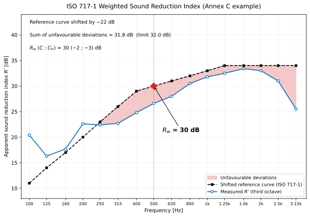</picture>

*A measured R spectrum against the shifted ISO 717-1 reference: the rating is the shifted reference read at 500 Hz.*

### Impact insulation (ISO 16283-2, ISO 717-2)

Impact insulation swaps the airborne source for a standardized **tapping
machine** and rates the receiving-room level, so the sign conventions flip. The
standardized and normalized impact levels are $L'_{\mathrm{n}T} = L_i - 10 \log_{10}(T/T_0)$
(the reverberation term is *subtracted*, opposite to $D_{\mathrm{n}T}$) and
$L'_\mathrm{n} = L_i + 10 \log_{10}(A/A_0)$ with $A_0 = 10$ m² and $A = 0.16\ V/T$. The
ISO 717-2 rating shifts the Table 3 reference curve until $\sum_i \max(0, \text{meas}_i - (\text{ref}_i + k))$
is maximal but $\le$ 32.0 dB (16 thirds) or 10.0 dB (5 octaves); the
*unfavourable* deviation now counts where the **measurement exceeds** the
reference (impact noise is worse when louder), the mirror image of ISO 717-1.
The rating is the shifted reference at 500 Hz, reduced by a further 5 dB for
octave bands, and the adaptation term is $C_\mathrm{I} = L_\mathrm{n,sum} - 15 - L_\mathrm{n,w}$
with the energetic sum $L_\mathrm{n,sum} = 10 \log_{10} \sum_i 10^{L_i/10}$ over
100–2500 Hz (thirds) or 125–2000 Hz (octaves). The ISO 717-2 Annex C examples
are reproduced exactly (thirds $L_\mathrm{n,w} = 79$, $C_\mathrm{I} = -11$; octaves $54$, $0$),
via the same monotone shift search as ISO 717-1 run on the negated curves.

<picture><source media="(prefers-color-scheme: dark)" srcset="https://raw.githubusercontent.com/jmrplens/phonometry/main/.github/images/impact_rating_dark.svg">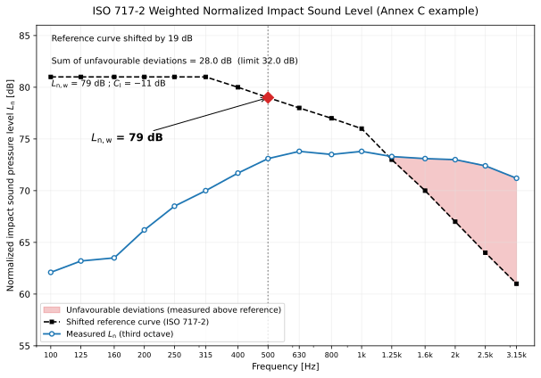</picture>

*The mirror image of the airborne figure above, drawn so the flip is visible
rather than asserted. There the unfavourable deviations were counted where the
measurement fell **below** the reference; here they are counted where it rises
**above** it, because a louder receiving room is a worse floor. Everything else
is the same procedure: the reference curve shifted in 1 dB steps until the
unfavourable sum is as large as it can be without passing 32.0 dB, and the
rating read off the shifted reference at 500 Hz.*

### Absorption in a reverberation room (ISO 354)

Sound absorption (ISO 354) measures the equivalent absorption area from
Sabine's relation applied to a reverberation room empty and with the specimen:
$A = 55.3\ V/(c\ T) - 4 V m$ (the $4 V m$ term is the air absorption, $m$ the
power attenuation coefficient in 1/m), so the specimen area is
$A_\mathrm{T} = A_2 - A_1$ and its coefficient $\alpha_\mathrm{s} = A_\mathrm{T}/S$. With the speed of
sound from Eq. (6), $c = 331 + 0.6\ t$ (°C), and $m$ converted from an
ISO 9613-1 attenuation coefficient by $m = \alpha / (10 \log_{10} e)$. Because
diffraction and edge scattering intercept more than the flat sample area,
$\alpha_\mathrm{s}$ is left unclamped and may exceed 1.0 (Clause 3.7 NOTE 2).

**The two reverberation times are not free inputs.** They are the output of a
tightly specified arrangement, and $\alpha_\mathrm{s}$ means nothing without it. The room
holds at least 150 m³ (200 m³ strongly recommended for a new one), its longest
dimension stays below $1.9\,V^{1/3}$, and it carries enough fixed or rotating
diffusion for the decays to be exponential (clause 6.1). The plane specimen
covers 10 to 12 m² (the upper limit scaled by $(V/200)^{2/3}$ above 200 m³) and is
rectangular with a width-to-length ratio between 0.7 and 1, sits at least 0.75 m
from any room boundary and preferably has its edges non-parallel to the nearest
room edge (6.2.1). Its **mounting is part of the result** (Annex B): rigid
backing, air gap or framed edges change the answer, which is why a catalogue
$\alpha_\mathrm{s}$ without its mounting code is not usable and why the same product
gives different curves in different laboratories. Each $T$ is the average of at
least 12 spatially independent decays, from at least 3 microphone and 2 source
positions (7.1.4), with microphones at least 1.5 m apart, 2 m from any source
and 1 m from any room surface and from the specimen (7.1.2), and source
positions at least 3 m apart (7.1.3). Both measurements are made between 30 %
and 90 % relative humidity and at 15 °C or more, at nearly the same climate
(6.3.2).

The diagram below draws that arrangement for a 200 m³ room and a 10.8 m² specimen.
It also shows what the paragraph leaves to the standard's own text: the
diffusers of Annex A, sheets of roughly 0.8 m² to 3 m² and about 5 kg/m²; the
empty-room absorption area $A_1$ that must stay under the Table 1 limit
(6.1.4), with $T_1$ measured without the frame of the specimen (6.2.1.3); each
decay evaluated over 20 dB starting 5 dB below the initial level (7.4.1); and
two of the Annex B mountings, Type A directly against the floor and Type E-400
with 400 mm between the exposed face and the surface behind it.

<picture><source media="(prefers-color-scheme: dark)" srcset="https://raw.githubusercontent.com/jmrplens/phonometry/main/.github/images/diagram_iso354_room_dark.svg"></picture>

That last condition is not housekeeping. The result is the *difference* of two
large and nearly equal absorption areas, so everything that changes between the
empty and the loaded measurement lands in it: a shift in temperature or humidity
moves both $c$ and the air term $4Vm$, which is why the two decays belong in the
same session with the climate recorded. And an $\alpha_\mathrm{s}$ above 1 is not an
error but the signature of edge diffraction intercepting more energy than the
flat projected area (largest for small specimens and at low frequency). The
value belongs to a specimen of *that* size, aspect ratio and mounting and cannot
be transplanted to a surface of another shape without judgement.

### Laboratory vs field normalization (ISO 10140, ISO 16283)

The field indices carry a prime because the receiving-room level they start from
includes flanking transmission around the partition; the laboratory indices do
not, because a qualified facility suppresses it. The formulas are therefore the
*same*, and the prime is a statement about the specimen rather than about the
arithmetic: the direct laboratory sound reduction index
$R = L_1 - L_2 + 10 \log_{10}(S/A)$ (ISO 10140-2) and the apparent field index
$R' = L_1 - L_2 + 10 \log_{10}(S/A)$ (ISO 16283-1) are one closed form,
evaluated with the facility's known $A$ in the laboratory and with the receiving
room's measured $A = 0.16\ V/T$ in the field. What differs in *what is
normalised* is not laboratory against field but airborne against impact: the
airborne indices scale by the area-to-absorption ratio $S/A$, the impact levels
by $A/A_0$.

<picture><source media="(prefers-color-scheme: dark)" srcset="https://raw.githubusercontent.com/jmrplens/phonometry/main/.github/images/diagram_insulation_lab_dark.svg">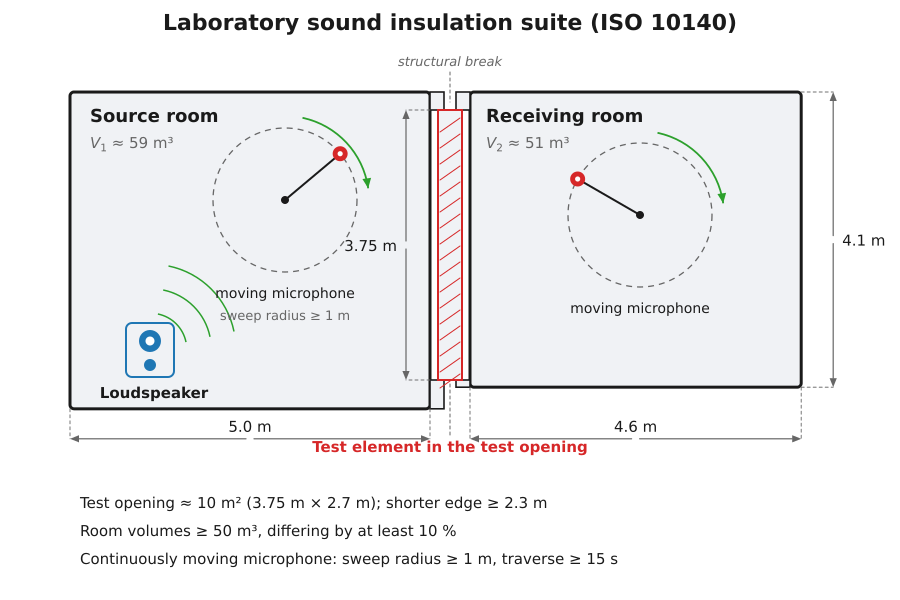</picture>

What "a qualified facility suppresses it" means physically is drawn above: an
ISO 10140-5 suite is two *structurally decoupled* reverberation rooms of roughly
50 to 60 m³ sharing a test opening of about 10 m², built so that transmission
around the specimen sits far below transmission through it. The facility
measures its own flanking limit, and a specimen may be reported only up to that
limit, which is why a laboratory $R$ carries no prime, and why the same
construction built into a building reads several decibels lower. The practical
consequence is a diagnosis: when a field $R'$ refuses to rise after the element
is improved, the measurement has hit a flanking path, not the element. The impact pair is the normalized laboratory level
$L_\mathrm{n} = L_i + 10 \log_{10}(A/A_0)$ (ISO 10140-3) versus the field $L'_\mathrm{n}$
(ISO 16283-2), both referenced to $A_0 = 10$ m². Before either is formed the
receiving-room level is corrected for background noise by the energy
subtraction $L = 10 \log_{10}(10^{L_\mathrm{sb}/10} - 10^{L_\mathrm{b}/10})$ for a 6–15 dB
signal-to-background margin, capped at a fixed $1.3$ dB (the limit of
measurement) at or below 6 dB and omitted at or above 15 dB (ISO 10140-4,
Clause 4.3), the laboratory analogue of the 6/10 dB rule of ISO 16283-1. The
façade extension (ISO 16283-3) replaces the source-room level by the level 2 m
in front of the façade, $D_{2\mathrm{m}} = L_{1,2\mathrm{m}} - L_2$, and adds a fixed
angle-of-incidence correction to the element sound reduction index, $-1.5$ dB
for the 45° loudspeaker method ($R'_{45°}$) and $-3$ dB for the all-angle
road-traffic method ($R'_\mathrm{tr,s}$); all three carry the ISO 717-1 airborne
single number.

## Sound insulation and absorption, predicted (EN 12354-1/-2/-6, Bies, Cremer, Hopkins)

### Flanking transmission prediction (EN 12354-1/2)

The apparent field index is the energetic sum of the direct path $Dd$ and, for
each flanking element $F=f$ across its junction with the separating element, the
three paths $Ff$, $Df$ and $Fd$ (EN 12354-1, simplified single-number model,
Formula 26):

<picture><source media="(prefers-color-scheme: dark)" srcset="https://raw.githubusercontent.com/jmrplens/phonometry/main/.github/images/diagram_flanking_paths_dark.svg">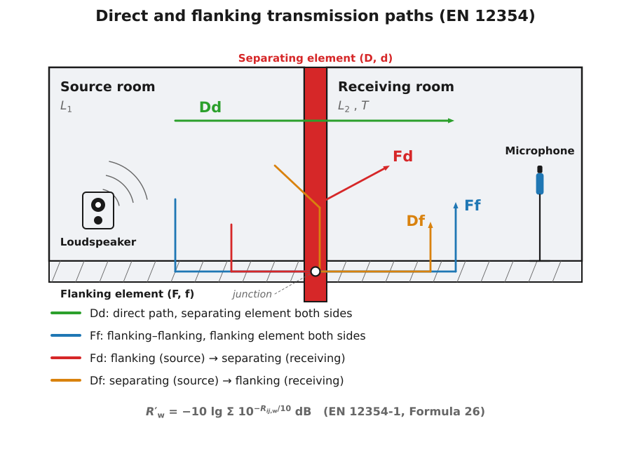</picture>

*The four labels are only meaningful on this drawing. Upper case is the source
side and lower case the receiving side, so $Dd$ goes straight through the
separating element, $Ff$ runs along a flanking element on both sides of the
junction, and $Df$ and $Fd$ cross from one to the other. The junction they cross
is where $K_{ij}$ and the coupling length $\ell_\mathrm{f}$ live in the formula below,
and the separating element is where $S_\mathrm{s}$ is measured. Each junction contributes
three flanking terms, so a room with four flanking elements sums thirteen paths.*

$$
R'_\mathrm{w} = -10 \log_{10}\Big[ 10^{-R_\mathrm{Dd,w}/10}
       + \sum 10^{-R_\mathrm{Ff,w}/10} + \sum 10^{-R_\mathrm{Df,w}/10}
       + \sum 10^{-R_\mathrm{Fd,w}/10} \Big].
$$

The direct path is $R_\mathrm{Dd,w} = R_\mathrm{s,w} + \Delta R_\mathrm{Dd,w}$ (Formula 27), the
separating-element laboratory index plus any lining improvement. Each flanking
path (Formula 28a) is

$$
R_{ij,\mathrm{w}} = \frac{R_{i,\mathrm{w}} + R_{j,\mathrm{w}}}{2} + \Delta R_{ij,\mathrm{w}} + K_{ij}
         + 10 \log_{10}\frac{S_\mathrm{s}}{l_0\ l_\mathrm{f}},
$$

with $R_{i,\mathrm{w}}$, $R_{j,\mathrm{w}}$ the laboratory indices of the two elements meeting at
the junction ($i$ source side, $j$ receiving side), $\Delta R_{ij,\mathrm{w}}$ the
combined lining improvement, $S_\mathrm{s}$ the separating-element area, $l_\mathrm{f}$ the
junction coupling length and $l_0 = 1$ m the reference coupling length. $K_{ij}$
is the junction **vibration reduction index** (Annex E), an empirical function of
the mass ratio $M = \log_{10}(m'_{\perp,i}/m'_i)$: for a rigid cross-junction
$K_{13} = 8.7 + 17.1 M + 5.7 M^2$ (through) and $K_{12} = 8.7 + 5.7 M^2$
(corner), read at 500 Hz, and floored at $K_{ij,\min} = 10 \log_{10}[l_\mathrm{f}\ l_0
(1/S_i + 1/S_j)]$ (Formula 29). Two linings combine as $\max(a,b) + \min(a,b)/2$
(Formulas 30/31). The impact counterpart (EN 12354-2, Formula 21) is the direct
subtraction $L'_\mathrm{n,w} = L_\mathrm{n,w,eq} - \Delta L_\mathrm{w} + K$, with the bare-floor
equivalent level $L_\mathrm{n,w,eq} = 164 - 35 \log_{10}(m'/m'_0)$ (Annex B), the
covering improvement $\Delta L_\mathrm{w}$ (ISO 717-2) and the flanking correction $K$
from Table 1. The EN 12354-1 Annex H.3 ($R'_\mathrm{w} = 52$ dB) and EN 12354-2 Annex E.3
($L'_\mathrm{n,w} = 45$ dB) worked examples are reproduced exactly.

**Where the simplified model applies.** It assumes homogeneous elements whose
transmission is governed by their mass per unit area, joined rigidly, so that the
junction attenuation can depend on the mass ratio alone; the Annex E regressions
are empirical fits to exactly that family. They return no meaningful answer for
framed lightweight constructions, for elastically decoupled junctions, or for
elements with a strong internal loss mechanism. Those need the detailed
band-by-band model or measured $K_{ij}$ values. The $K_{ij,\min}$ floor exists
to stop the regressions producing implausibly high junction attenuations for
small elements, so a path that lands on the floor is a signal that the mass-ratio
fit is at the edge of its range rather than a result to report as-is. Because the
paths sum energetically, the apparent rating is pinned by whichever path is
strongest: improving the separating element alone stops paying the moment one
flanking path dominates, and identifying *that* path is the model's chief
practical value, well before the last decibel of the total. The 2 dB standard
deviation the standard quotes (Clause 5) is the spread of the simplified model
against measurement **inside that intended population**, not a general error bar.

### Absorption in enclosed spaces (EN 12354-6)

EN 12354-6:2003 predicts the equivalent absorption area of a room from its
parts (the normative Clause 4 model). The total (Formula 1) sums the surfaces,
the objects and the air:

$$
A = \sum_i \alpha_{\mathrm{s},i}\ S_i + \sum_j A_{\mathrm{obj},j} + \sum_k \alpha_{\mathrm{s},k}\ S_k + A_\mathrm{air},
\qquad A_\mathrm{air} = 4\ m\ V\ (1 - \psi),
$$

with $m$ the power attenuation coefficient of air (Formula 2; Table 1
tabulates it for six temperature/humidity climates over the octave bands
125 Hz – 8 kHz), $\psi = \sum V_\mathrm{obj} / V$ the volume fraction occupied by
objects (Formula 3), and a hard irregular object approximated by
$A_\mathrm{obj} = V_\mathrm{obj}^{2/3}$ (Formula 4). The reverberation time follows from
Sabine applied to the free volume (clause 4.4, Formula 5):

$$
T = \frac{55.3}{c_0}\ \frac{V\ (1 - \psi)}{A},
$$

with $c_0 = 345.6$ m/s chosen so that $55.3/c_0$ is the familiar $0.16$
(clause 4.4 NOTE). The three Annex E worked cases are reproduced: the
bare 29.75 m³ room gives $A = 2.26$ m² and $T = 2.1$ s at 1 kHz, and adding
hard objects ($\psi \approx 0.072$) raises $A$ to 5.03 m² and drops $T$ to
0.9 s. The informative Annex D method for irregular spaces and unevenly
distributed absorption is out of scope.

<picture><source media="(prefers-color-scheme: dark)" srcset="https://raw.githubusercontent.com/jmrplens/phonometry/main/.github/images/enclosed_space_absorption_dark.svg">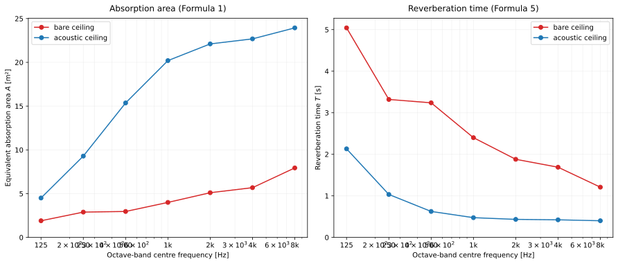</picture>

*What Formula 1 does band by band: the equivalent absorption area on the left
and the reverberation time it implies through Formula 5 on the right, for the
same room bare and treated. The Annex E case quoted above is the same
arithmetic on a smaller room: $A$ from 2.26 to 5.03 m² and $T$ from 2.1 to
0.9 s at 1 kHz, and the figure shows why the two move in opposite directions
and not proportionally.*

See the [Enclosed-Space Absorption guide](../../buildings/rooms/enclosed-space-absorption.md) for usage.

### Predicted panel sound insulation (Bies 7.2, Hopkins 2.9/4.3.10, Cremer 5)

Where EN 12354 takes the element $R$ as a measurement, the sound reduction index
of a panel can also be **predicted** from its physical properties. A limp panel
follows the mass law $TL_0 = 10\log_{10}[1 + (\pi f m''/\rho_0 c_0)^2]$ (Bies Eq. 7.40),
which rises 6 dB per octave and 6 dB per doubling of the surface mass $m''$ (the
$m'$ of the EN 12354 subsections above); the
field-incidence value subtracts 5.5 dB (one-third octave). That 5.5 dB is not
derived: it is the result of averaging the normal-incidence mass law over
incidence angles up to the limiting angle observed in practice rather than over
the full hemisphere, so it is a fixed empirical offset and not a function of
anything. Stiffness adds a
**coincidence dip** at $f_\mathrm{c} = (c_0^2/2\pi)\sqrt{m''/B'}$ (Eq. 7.3), where the free
bending wavelength matches the acoustic trace wavelength. Sharp's method holds
the mass law to $f_\mathrm{c}/2$, drops linearly in $\log f$ to the dip
$TL = 20\log_{10}(f_\mathrm{c} m'') + 10\log_{10}\eta - 44$ and rises again above $f_\mathrm{c}$ with the loss
factor $\eta$ (Eq. 7.44); the $-44$ there is an empirical fit to measured
coincidence dips, and the loss factor appears explicitly because the depth of the
dip is controlled by damping rather than by mass. A **double wall** is a
mass-spring-mass system with the
cavity as the spring: below $f_0 = 60\sqrt{(m_1+m_2)/(m_1 m_2 d)}$ (Eq. 7.62) it
follows the mass law of the combined mass, and above it the two leaves' mass laws
add plus the cavity term $20\log_{10}(2kd)$, saturating at +6 dB beyond
$f_\mathrm{l} = c_0/(2\pi d)$ (Eq. 7.64); a porous fill lowers $f_0$. The 60 in $f_0$ is
the numeric constant left once the stiffness of an air layer of thickness $d$ is
substituted into the mass-spring-mass resonance, so it is fixed to air at
ordinary conditions and changes for a gas-filled or evacuated cavity; and $f_\mathrm{l}$
marks where half a wavelength fits across the cavity, above which the cavity
stops behaving as a pure spring and standing waves in it limit what the
construction can achieve. Small air paths cap
any construction: the transmission coefficient of a straight slit (Gomperts,
Hopkins Eq. 4.99, with resonances at $d + 2e = z\lambda/2$) or a circular hole
(Wilson & Soroka, Eq. 4.102) combines with the wall in the area-weighted energy
sum $R = -10\log_{10}[(1/\sum S_n)\sum S_n 10^{-R_n/10}]$ (Eq. 4.92), so a bare opening
of relative area $S_\mathrm{a}/S$ limits the composite to $10\log_{10}(S/S_\mathrm{a})$. The resonant
transmission path and the double-wall radiation draw on the plate radiation
efficiency and point mobilities of the
[vibration theory](vibration.md).

<picture><source media="(prefers-color-scheme: dark)" srcset="https://raw.githubusercontent.com/jmrplens/phonometry/main/.github/images/panel_insulation_concept_dark.svg">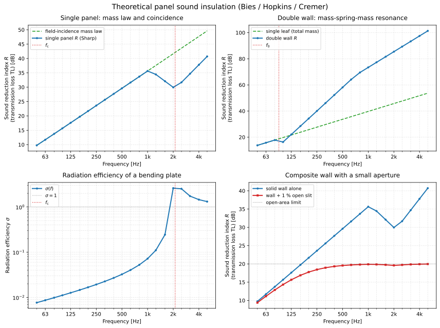</picture>

*The four behaviours of the paragraph above, one per panel. Top left, the mass
law rising 6 dB per octave with Sharp's coincidence dip cut into it at $f_\mathrm{c}$.
Top right, the double wall: no better than the combined mass below $f_0$, then
the cavity term climbing until it saturates. Bottom left, the radiation
efficiency that decides how much of the plate's vibration becomes sound. Bottom
right, the ceiling a leak imposes: a 1 % open area holds the composite at
$10\log_{10}(S/S_\mathrm{a}) = 20$ dB however good the wall is, which is the panel worth
showing a client.*

The dip of the top left panel is a matching of wavelengths, and it can be
watched. At $f_\mathrm{c}$ the free bending wavelength equals the trace of a wave at
grazing incidence; for any smaller angle of incidence there is a frequency above
$f_\mathrm{c}$ at which the two match again (Bies 7.2.1). With a trace of
$\lambda/\sin\theta$ at an angle $\theta$ from the normal, and a bending
wavelength that falls as $1/\sqrt{f}$, that frequency is
$f_\mathrm{c}/\sin^2\theta$, which is $2 f_\mathrm{c}$ at 45°. The clip sends a sustained
plane wave at 45° onto a 10 mm steel plate, for which the library gives
$f_\mathrm{c} = 1205$ Hz, at half that frequency and at twice it:

**Video:** [Coincidence on a 10 mm steel plate in a 2D elastic FDTD simulation](https://raw.githubusercontent.com/jmrplens/phonometry-assets/121efdf58a806512db6b3ce160760f280e642f53/images/anim_elastic_coincidence.webm): Two side-by-side elastic FDTD fields of the same 10 mm steel plate lying in air while a sustained plane wave arrives at 45 degrees. At 602 Hz, half the coincidence frequency, the wave reflects almost totally and the faint transmitted level matches the oblique mass law. At 2410 Hz, twice the coincidence frequency, the acoustic trace matches the free bending wavelength and a 45-degree transmitted beam grows below the plate, holding the same level as the low-frequency panel where the mass law predicted 12 dB more insulation, the air below the plate drawn on both panels with an annotated 150-fold display gain (+44 dB) so the transmitted field is legible, with the 1205 Hz coincidence frequency of the library and both measured and mass-law levels annotated.

*At 602 Hz the plate lets through −47 dB, where the oblique mass law predicts
−48 dB. At 2410 Hz it still lets through −47 dB, where the mass law said −60 dB:
the 12 dB that two octaves should have added are gone. The air below the plate
is drawn with a gain of 150 (+44 dB) on both panels so that the transmitted
field shows.*

<picture><source media="(prefers-color-scheme: dark)" srcset="https://raw.githubusercontent.com/jmrplens/phonometry/main/.github/images/aperture_slit_geometry_dark.svg">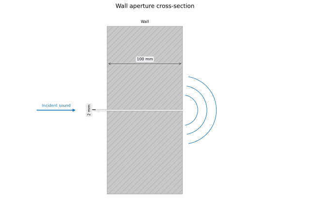</picture>

See the [Predicting Panel Sound Insulation](../../buildings/design/panel-sound-insulation.md)
guide for usage.

## Measurement uncertainty (ISO 12999-1)

ISO 12999-1 supplies the uncertainty of the quantities above from
inter-laboratory (ISO 5725) reproducibility and repeatability rather than a
GUM functional model. Three **measurement situations** fix the standard
uncertainty $u$: situation **A** (laboratory characterisation) uses the
reproducibility standard deviation $\sigma_\mathrm{R}$; situation **B** (same location,
different teams) the in-situ $\sigma_\mathrm{situ}$; situation **C** (same location,
operator and equipment, repeated) the repeatability $\sigma_\mathrm{r}$. The per-band and
single-number values are tabulated for airborne $R$/$R'$/$D_\mathrm{n}$/$D_{\mathrm{n}T}$
(Tables 2/3), impact $L_\mathrm{n}$/$L'_\mathrm{n}$ (Table 4 bands, situations B/C only; Table 5
ratings adding a situation-A estimate) and the
covering reduction $\Delta L$ (Tables 6/7, situation A only). The expanded
uncertainty is $U = k\ u$ (Formula 2) with the coverage factor $k$ of Table 8
(at 95 %, $k = 1.96$ two-sided, $k = 1.65$ one-sided; a minimum $k = 1$ is
enforced). A two-sided interval $Y = y \pm U$ reports a value (Formula 3); a
one-sided factor declares conformity, $y - U > $ requirement for a lower limit
(Formula 5) or $y + U <$ requirement for an upper limit (Formula 4).
Uncorrelated components combine in quadrature $u_\mathrm{c} = \sqrt{\sum u_i^2}$
(Formula C.2), $m$ independent measurements reduce $u$ to $u/\sqrt{m}$
(Formula A.7), and the uncorrelated single-number uncertainty is the
energy-weighted quadrature sum of the band uncertainties (Formula B.2).

See the [Room Acoustics](../../buildings/rooms/room-acoustics.md) and
[Field Insulation Measurement (ISO 16283)](../../buildings/insulation/insulation-field.md) guides for usage.

## References

- **Acoustical Society of America. (2019).** [*Criteria for evaluating room noise*](https://webstore.ansi.org/standards/asa/ansiasas122019) (ANSI/ASA S12.2-2019).
  The normative NC tangency method and the Annex D RC Mark II rating with its spectral tag.
- **Allen, J. B., & Berkley, D. A. (1979).** Image method for efficiently simulating small-room acoustics. *The Journal of the Acoustical Society of America*, *65*(4), 943-950. https://doi.org/10.1121/1.382599
  The reflection-count decomposition of the rectangular-room image lattice.
- **Beranek, L. L. (1957).** Revised criteria for noise in buildings. *Noise Control*, *3*(1), 19-27. https://doi.org/10.1121/1.2369239
  The original NC curves rated by the tangency method of the room-noise section.
- **Bies, D. A., Hansen, C. H., & Howard, C. Q. (2017).** *Engineering noise control* (5th ed.). CRC Press. https://doi.org/10.1201/9781351228152
  ISBN 978-1-138-30690-5. The steady-state room field and the room constant (Section 6.4, Eqs. 6.43 and 6.44), and the mass law, coincidence, double-wall and composite-partition equations (7.3, 7.40, 7.44, 7.62, 7.64) of the panel-prediction subsection.
- **Blazier, W. E. (1997).** RC Mark II: A refined procedure for rating the noise of heating, ventilating, and air-conditioning (HVAC) systems in buildings. *Noise Control Engineering Journal*, *45*(6), 243-250. https://doi.org/10.3397/1.2828446
  The RC Mark II contour and spectral-quality tag codified by ANSI/ASA S12.2 Annex D.
- **Cremer, L., Heckl, M., & Petersson, B. A. T. (2005).** *Structure-borne sound: Structural vibrations and sound radiation at audio frequencies* (3rd ed.). Springer. https://doi.org/10.1007/b137728
  ISBN 978-3-540-22696-3. The structure-borne transmission and radiation theory the panel-prediction subsection draws on, shared with the vibration theory page.
- **European Committee for Standardization. (2000).** [*Building acoustics — Estimation of acoustic performance of buildings from the performance of elements — Part 1: Airborne sound insulation between rooms*](https://knowledge.bsigroup.com/products/building-acoustics-estimation-of-acoustic-performance-in-buildings-from-the-performance-of-elements-airborne-sound-insulation-between-rooms) (EN 12354-1:2000).
  The simplified single-number flanking model (Formulae 26-31), the Annex E junction regressions and the Annex H.3 worked example of the flanking subsection.
- **European Committee for Standardization. (2000).** [*Building acoustics — Estimation of acoustic performance of buildings from the performance of elements — Part 2: Impact sound insulation between rooms*](https://knowledge.bsigroup.com/products/building-acoustics-estimation-of-acoustic-performance-in-buildings-from-the-performance-of-elements-impact-sound-insulation-between-rooms) (EN 12354-2:2000).
  The impact counterpart of the same subsection: Formula 21, the Annex B bare-floor equivalent level and the Annex E.3 worked example.
- **European Committee for Standardization. (2003).** [*Building acoustics — Estimation of acoustic performance of buildings from the performance of elements — Part 6: Sound absorption in enclosed spaces*](https://knowledge.bsigroup.com/products/building-acoustics-estimation-of-acoustic-performance-of-buildings-from-the-performance-of-elements-sound-absorption-in-enclosed-spaces) (EN 12354-6:2003).
  The Clause 4 absorption model and Annex E worked cases of the enclosed-space section. The linked catalogue record is the BSI Knowledge page for BS EN 12354-6:2003.
- **Hak, C. C. J. M., Wenmaekers, R. H. C., & van Luxemburg, L. C. J. (2012).** Measuring room impulse responses: Impact of the decay range on derived room acoustic parameters. *Acta Acustica united with Acustica*, *98*(6), 907-915. https://doi.org/10.3813/aaa.918574
  The INR decay-range analysis behind the tightened T20/T30 validity thresholds.
- **Hopkins, C. (2007).** *Sound insulation*. Butterworth-Heinemann. https://doi.org/10.4324/9780080550473
  ISBN 978-0-7506-6526-1. The measurement chains, flanking transmission and EN 12354 prediction framework of the insulation sections.
- **International Organization for Standardization. (2003).** [*Acoustics — Measurement of sound absorption in a reverberation room*](https://www.iso.org/standard/34545.html) (ISO 354:2003).
  The reverberation-room absorption measurement and its air-absorption term.
- **International Organization for Standardization. (2006).** [*Acoustics — Application of new measurement methods in building and room acoustics*](https://www.iso.org/standard/40408.html) (ISO 18233:2006).
  The swept-sine and MLS deconvolution of the deterministic-excitation section.
- **International Organization for Standardization. (2008).** [*Acoustics — Measurement of room acoustic parameters — Part 2: Reverberation time in ordinary rooms*](https://www.iso.org/standard/36201.html) (ISO 3382-2:2008).
  The regression windows, dynamic-range rules and curvature check of the validity section.
- **International Organization for Standardization. (2009).** [*Acoustics — Measurement of room acoustic parameters — Part 1: Performance spaces*](https://www.iso.org/standard/40979.html) (ISO 3382-1:2009).
  Backward integration, the parameter definitions and the Annex A clarity family.
- **International Organization for Standardization. (2012).** [*Acoustics — Measurement of room acoustic parameters — Part 3: Open plan offices*](https://www.iso.org/standard/46520.html) (ISO 3382-3:2012).
  The open-plan spatial decay and the distraction and privacy distances. Since revised as ISO 3382-3:2022 (https://www.iso.org/standard/77437.html); the 2012 edition is the implemented one.
- **International Organization for Standardization. (2014).** [*Acoustics — Field measurement of sound insulation in buildings and of building elements — Part 1: Airborne sound insulation*](https://www.iso.org/standard/55997.html) (ISO 16283-1:2014).
  The field level differences and normalizations of the insulation sections.
- **International Organization for Standardization. (2016).** [*Acoustics — Field measurement of sound insulation in buildings and of building elements — Part 3: Façade sound insulation*](https://www.iso.org/standard/59748.html) (ISO 16283-3:2016).
  The façade extension of the laboratory-versus-field subsection: the 2 m reference position and the angle-of-incidence corrections.
- **International Organization for Standardization. (2020).** [*Acoustics — Determination and application of measurement uncertainties in building acoustics — Part 1: Sound insulation*](https://www.iso.org/standard/73930.html) (ISO 12999-1:2020).
  The measurement situations, tabulated uncertainties and coverage factors of the uncertainty section.
- **International Organization for Standardization. (2020).** [*Acoustics — Field measurement of sound insulation in buildings and of building elements — Part 2: Impact sound insulation*](https://www.iso.org/standard/77436.html) (ISO 16283-2:2020).
  The field impact-level measurement behind L'nT and L'n in the impact-insulation subsection.
- **International Organization for Standardization. (2020).** [*Acoustics — Rating of sound insulation in buildings and of building elements — Part 1: Airborne sound insulation*](https://www.iso.org/standard/77435.html) (ISO 717-1:2020).
  The reference-curve shift and the spectrum adaptation terms C and Ctr.
- **International Organization for Standardization. (2020).** [*Acoustics — Rating of sound insulation in buildings and of building elements — Part 2: Impact sound insulation*](https://www.iso.org/standard/69867.html) (ISO 717-2:2020).
  The impact single-number rating and the CI adaptation term, with the Annex C worked examples the impact-insulation subsection reproduces.
- **International Organization for Standardization. (2021).** [*Acoustics — Laboratory measurement of sound insulation of building elements — Part 2: Measurement of airborne sound insulation*](https://www.iso.org/standard/79487.html) (ISO 10140-2:2021).
  The laboratory sound reduction index R of the laboratory-versus-field subsection.
- **International Organization for Standardization. (2021).** [*Acoustics — Laboratory measurement of sound insulation of building elements — Part 3: Measurement of impact sound insulation*](https://www.iso.org/standard/79483.html) (ISO 10140-3:2021).
  The laboratory normalized impact level Ln of the same subsection.
- **International Organization for Standardization. (2021).** [*Acoustics — Laboratory measurement of sound insulation of building elements — Part 4: Measurement procedures and requirements*](https://www.iso.org/standard/73911.html) (ISO 10140-4:2021).
  Clause 4.3, the background-noise correction and its 6/15 dB margins and 1.3 dB cap, quoted in the laboratory-versus-field subsection.
- **International Organization for Standardization. (2021).** [*Acoustics — Laboratory measurement of sound insulation of building elements — Part 5: Requirements for test facilities and equipment*](https://www.iso.org/standard/79482.html) (ISO 10140-5:2021).
  The qualified transmission suite drawn in the laboratory-versus-field subsection, and the flanking limit that lets a laboratory index drop its prime.
- **Kuttruff, H. (2016).** *Room acoustics* (6th ed.). CRC Press. https://doi.org/10.1201/9781315372150
  The statistical decay theory behind backward integration and the Sabine relations used throughout this page, the image-source construction (Section 4.1) and the impulse response it sums (Section 4.2), the Eyring reverberation (Section 5.4), the reverberation distance (Section 5.6) and the Schroeder frequency (Section 3.6).
- **Schroeder, M. R. (1965).** New method of measuring reverberation time. *The Journal of the Acoustical Society of America*, *37*(3), 409-412. https://doi.org/10.1121/1.1909343
  The backward-integration method of the decay-curve section.
- **Vigran, T. E. (2008).** *Building acoustics*. CRC Press. https://doi.org/10.1201/9781482266016
  ISBN 978-0-415-42853-8. Sound transmission in buildings, from single and double constructions to floating floors.
- **Vorländer, M. (2020).** *Auralization: Fundamentals of acoustics, modelling, simulation, algorithms and acoustic virtual reality* (2nd ed.). Springer. https://doi.org/10.1007/978-3-030-51202-6
  The mirror-source model of the image-source subsection (Chapter 11), with its mirroring and reflection-factor expressions (Eqs. 11.36 and 11.39).
